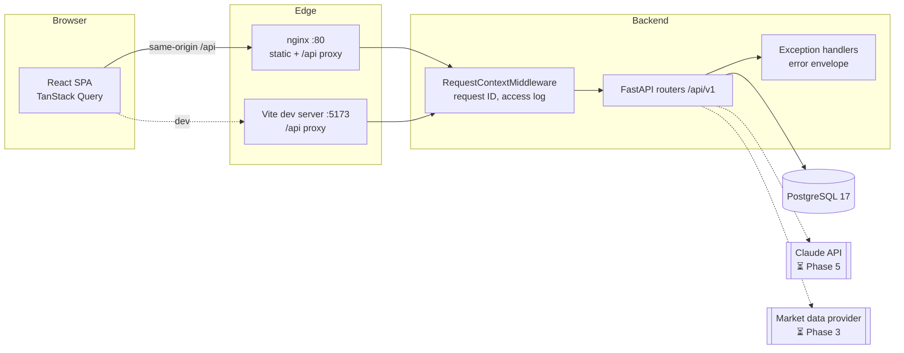
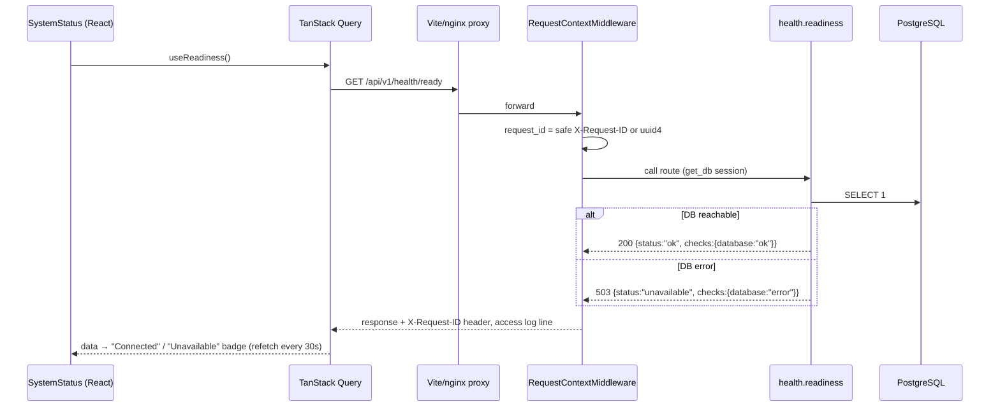
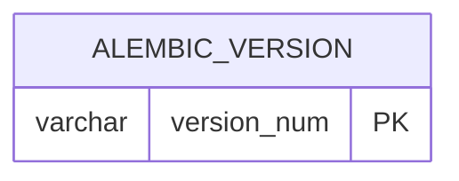

# FinSight — System Flow

> **Single source of truth for the system as actually implemented.**
> Anything not yet built is explicitly marked **Planned** with its target phase. If code and
> this document disagree, the code is wrong or this document is stale — fix one of them in the
> same change.

- Last updated: 2026-10-15 (Phase 1 — foundation)
- Status legend: ✅ implemented & verified by tests · 🟡 implemented, not fully verified ·
  ⏳ planned (phase) · ❌ not started

---

## 1. Feature matrix

| # | Feature | Status | Phase | Verification |
|---|---------|--------|-------|--------------|
| F0 | Health checks (`/health/live`, `/health/ready`) | ✅ | 1 | `backend/tests/test_health.py`, `frontend/src/features/health/SystemStatus.test.tsx` |
| F0 | Uniform error envelope + request IDs + JSON logging | ✅ | 1 | `backend/tests/test_health.py` |
| F0 | Config via env, secrets masked | ✅ | 1 | `backend/tests/test_config.py` |
| F0 | Alembic migration chain (baseline) | ✅ | 1 | `backend/tests/test_migrations.py` — SQLite locally; PostgreSQL 17 in CI (16/16 passed, run 38623910065) |
| F0 | Docker images | ✅ | 1 | Both images build in CI `docker` job |
| F0 | Docker Compose stack (`up`) | 🟡 | 1 | `docker compose config` validated; full `up` not yet run (no local Docker daemon) |
| F0 | GitHub Actions CI | ✅ | 1 | Green on `main` and `dev/claude` (github.com/unknownMagician/finsight) |
| F1 | Company search & profiles | ⏳ | 3–4 | — |
| F2 | Financial statements & ratios | ⏳ | 2–4 | — |
| F3 | DCF valuation + sensitivity | ⏳ | 2–4 | — |
| F4 | Comparable company valuation | ⏳ | 2–4 | — |
| F5 | Forecasting (bull/base/bear) | ⏳ | 2–4 | — |
| F6 | Annual report PDF upload & fact extraction | ⏳ | 5 | — |
| F7 | AI research assistant with citations | ⏳ | 5 | — |
| F8 | Research report generation & export | ⏳ | 6 | — |
| F9 | Watchlists & personalized dashboard | ⏳ | 3–4 | — |
| S1 | Authentication & resource-level authorization | ⏳ | 3 | — |
| S2 | Rate limiting | ⏳ | 3 | — |

---

## 2. Repository structure (actual)

```
.
├── CLAUDE.md                 # Working rules for AI agents in this repo
├── README.md                 # Setup & usage
├── SYSTEM_FLOW.md            # This document
├── docker-compose.yml        # db (Postgres 17) + backend + frontend (nginx)
├── .env.example              # Template; real .env is git-ignored
├── .github/workflows/ci.yml  # backend, frontend, docker jobs
├── backend/
│   ├── pyproject.toml        # deps + ruff/mypy/pytest config
│   ├── alembic.ini
│   ├── alembic/
│   │   ├── env.py            # reads URL from app settings
│   │   └── versions/0001_baseline.py
│   ├── app/
│   │   ├── main.py           # create_app(): middleware, handlers, routers
│   │   ├── core/
│   │   │   ├── config.py     # Settings (pydantic-settings, FINSIGHT_* env)
│   │   │   ├── logging.py    # JSON formatter, request_id context var
│   │   │   ├── middleware.py # RequestContextMiddleware (request ID + access log)
│   │   │   └── errors.py     # AppError + exception handlers → error envelope
│   │   ├── db/
│   │   │   ├── base.py       # DeclarativeBase with naming convention
│   │   │   └── session.py    # lazy engine/sessionmaker, get_db dependency
│   │   ├── models/__init__.py# model registry for Alembic (no tables yet)
│   │   └── api/health.py     # /health/live, /health/ready
│   ├── tests/                # pytest: health, config, migrations
│   └── Dockerfile
└── frontend/
    ├── package.json          # Vite + React 19 + TS + Tailwind 4 + Router 8 + TanStack Query 5
    ├── vite.config.ts        # dev proxy /api → backend; Vitest config
    ├── nginx.conf            # prod: static SPA + /api reverse proxy
    ├── Dockerfile
    └── src/
        ├── main.tsx          # QueryClientProvider + RouterProvider
        ├── app/              # routes, Layout, queryClient defaults
        ├── lib/api.ts        # apiFetch + ApiError (parses error envelope)
        ├── features/health/  # useLiveness/useReadiness hooks, SystemStatus card
        ├── pages/            # HomePage, NotFoundPage
        └── test/             # Vitest setup + render/fetch helpers
```

Planned backend layout (to be confirmed as implemented): `app/domain/` (pure financial
calculations, no I/O), `app/services/` (orchestration), `app/providers/` (market data, Claude
adapter), `app/api/` (routers), `app/models/` (ORM), `app/schemas/` (Pydantic I/O).

---

## 3. Architecture



**Security boundary:** the browser only ever calls same-origin `/api/v1/*`. All secrets
(`FINSIGHT_DATABASE_URL`, `FINSIGHT_ANTHROPIC_API_KEY`, `FINSIGHT_JWT_SECRET`) live in the
backend process environment. The frontend bundle contains no credentials and no provider URLs.

---

## 4. Request flows

### 4.1 Health check (implemented)



- **Origin:** browser query on page load.
- **Validation:** none needed (no input). Response typed by `ReadinessResponse` (Pydantic) and
  mirrored by the TS interface in `frontend/src/features/health/api.ts`.
- **Functions:** `app.api.health.readiness` → `app.db.session.check_database`.
- **Tables:** none (connectivity probe only).
- **Note:** `useReadiness` treats 503 as a valid answer (reads the body) rather than an error.

### 4.2 Error flow (implemented)

1. Any exception raised inside a route is caught by a handler in `app/core/errors.py`:
   - `AppError` → its own `code`/`status_code`.
   - `HTTPException` (e.g. 404) → `code: "http_error"`.
   - `RequestValidationError` → 422, `code: "validation_error"`, `details: [{loc,msg,type}]`.
   - Any other `Exception` → logged with stack trace; client receives 500
     `code: "internal_error"` and a generic message (no internals).
2. Every envelope includes `request_id`, equal to the `X-Request-ID` response header.
   Unhandled 500s run in Starlette's outer `ServerErrorMiddleware`, so the middleware also
   stores the ID on `scope["state"]` for that handler to read.
3. Frontend `apiFetch` converts non-2xx into `ApiError{status, code, message, requestId, details}`;
   network failure → `status: 0, code: "network_error"`. TanStack Query does not retry 4xx.

---

## 5. API reference (implemented)

Base path: `/api/v1`. OpenAPI at `/openapi.json`, Swagger UI at `/docs` (disabled when
`FINSIGHT_ENVIRONMENT=production`).

| Method | Path | Auth | Response 200 | Other |
|--------|------|------|--------------|-------|
| GET | `/health/live` | none | `LivenessResponse {status:"ok", service, version, environment}` | — |
| GET | `/health/ready` | none | `ReadinessResponse {status:"ok", checks:{database:"ok"}}` | 503 same schema with `"unavailable"`/`"error"` |

Error envelope (all non-2xx):

```json
{"error": {"code": "validation_error", "message": "Request validation failed",
           "request_id": "6f1c…", "details": [{"loc": ["query","n"], "msg": "…", "type": "…"}]}}
```

---

## 6. Database

- Engine: PostgreSQL 17 (driver `psycopg` 3). Tests default to SQLite for speed; CI also runs
  the suite against a Postgres service via `TEST_DATABASE_URL`.
- Migrations: Alembic, linear chain, one head (enforced by `test_single_head`).
- Constraint naming convention defined in `app/db/base.py` for deterministic migrations.
- Drift guard: `test_models_match_migrations` fails if ORM models and migrations differ.

| Revision | Description | Tables |
|----------|-------------|--------|
| `0001` | Baseline — establishes the chain | *(none; only `alembic_version`)* |



Domain tables (users, companies, filings, statements, line items, valuations, documents,
chunks, watchlists, reports) are ⏳ planned for Phases 2–6 and will be documented here when
their migrations exist.

---

## 7. External financial data providers

⏳ Planned (Phase 3). No provider is integrated; **the system currently holds no market data or
financial statements.** Requirements for whichever provider is chosen: every stored figure
records source, retrieval timestamp, currency, unit/scale, and reporting period; missing values
are stored as missing (never zero-filled or invented).

## 8. Data ingestion & normalization

⏳ Planned (Phase 3).

## 9. Financial calculations

⏳ Planned (Phase 2). Each formula will be listed here with its function name, inputs,
validation rules, and test file. None are implemented yet.

## 10. DCF valuation & sensitivity

⏳ Planned (Phase 2).

## 11. PDF upload, extraction, chunking, retrieval

⏳ Planned (Phase 5). nginx already caps request bodies at 25 MB for `/api/`.

## 12. AI prompting, retrieval, citation validation

⏳ Planned (Phase 5). The Claude API key is a backend-only setting
(`FINSIGHT_ANTHROPIC_API_KEY`); all model calls will go through a backend provider adapter.

## 13. Authentication, authorization, security

Implemented:
- Secrets read only from backend env (`Settings`), typed `SecretStr` (masked in repr/logs).
- `.env` git-ignored; `.env.example` contains placeholders only.
- CORS allow-list from `FINSIGHT_CORS_ORIGINS` (explicit methods/headers).
- Client-supplied `X-Request-ID` accepted only if it matches `^[A-Za-z0-9._-]{1,64}$`
  (prevents log injection); otherwise a new UUID is generated.
- 500 responses never include exception text.
- OpenAPI/docs disabled in production.
- nginx adds `X-Content-Type-Options`, `X-Frame-Options`, `Referrer-Policy`.
- Compose binds ports to `127.0.0.1` and requires `POSTGRES_PASSWORD`.
- Backend container runs as non-root user `finsight` (uid 10001).

⏳ Planned (Phase 3): user accounts, password hashing, JWT/session auth, per-resource ownership
checks, rate limiting.

## 14. Error handling, logging, retries, background jobs

- **Logging:** `app/core/logging.py` — one JSON object per line on stdout
  (`ts, level, logger, msg, request_id, …extra`). Access log line per request with
  `method, path, status, duration_ms`. Toggle with `FINSIGHT_LOG_JSON`.
- **Errors:** see §4.2.
- **Retries:** frontend TanStack Query retries non-4xx failures up to 2 times. No backend retries
  yet (no outbound calls exist).
- **Background jobs:** none yet.

## 15. Deployment & testing workflows

| Workflow | Command | Where |
|----------|---------|-------|
| Backend tests | `pytest` (in `backend/`) | local (SQLite), CI (Postgres) |
| Backend lint/format/types | `ruff check .`, `ruff format --check .`, `mypy` | local, CI |
| Frontend tests | `npm test` (Vitest + RTL, jsdom) | local, CI |
| Frontend lint/build | `npm run lint`, `npm run build` (includes `tsc`) | local, CI |
| Full stack | `docker compose up --build` | local |
| Image builds | `docker build ./backend`, `docker build ./frontend` | CI `docker` job |
| E2E (Playwright) | ⏳ Phase 4 | — |

Container start-up: backend runs `alembic upgrade head` then `uvicorn`. Compose waits for
`db` healthy → `backend` healthy (`/health/ready`) → `frontend`.
