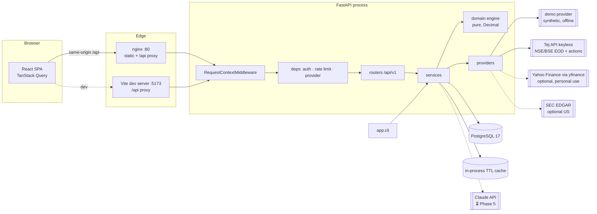
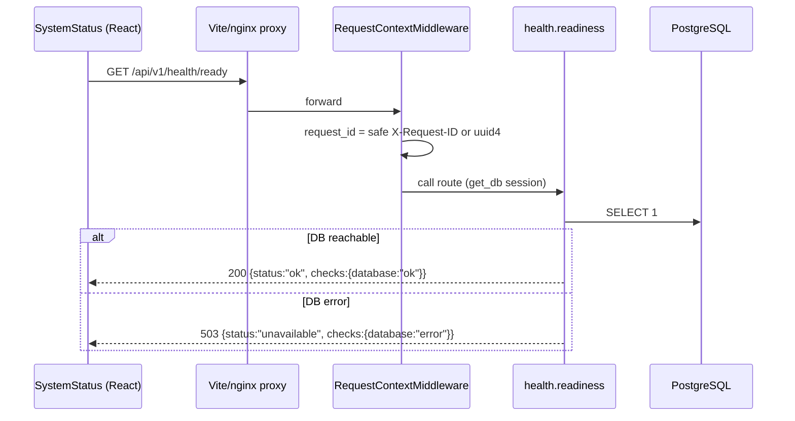
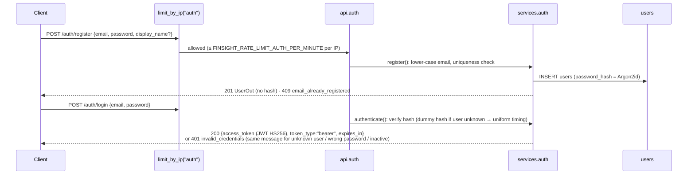
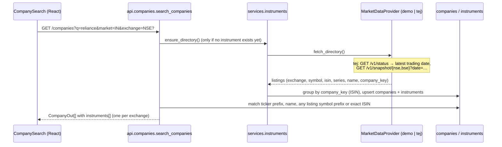
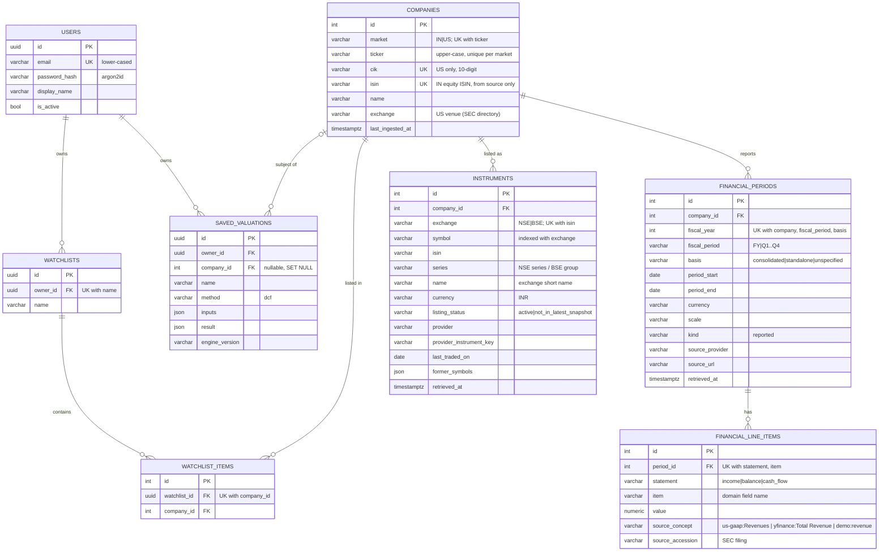

# FinSight — System Flow

> **Single source of truth for the system as actually implemented.**
> Anything not yet built is explicitly marked **Planned** with its target phase. If code and
> this document disagree, the code is wrong or this document is stale — fix one of them in the
> same change.

- Last updated: 2026-10-18 (Phases 4–7 complete: workspace UI, annual reports + AI with verified citations, reports & export, security audit)
- Status legend: ✅ implemented & verified by tests · 🟡 implemented, not fully verified ·
  ⏳ planned (phase) · ❌ not started

---

## 0. Market direction: India-first (migrated from SEC EDGAR, 2026-10-18)

FinSight now primarily covers companies listed on **NSE and BSE**. The original SEC EDGAR
integration (US, annual 10-K) is kept as an **optional US market** (`?market=US`), because it is
already isolated behind the `FinancialDataProvider` protocol, costs nothing to keep, and its
tests still pass unchanged. Nothing SEC-related was dropped from the database; existing rows were
backfilled as `market = 'US'` (migration `0003`).

Constraint: **only ₹0 data sources** are integrated, and the default configuration needs no
credentials and no network (deterministic `demo` provider).

| Concern | Before | Now |
|---|---|---|
| Default market | US only | `FINSIGHT_DEFAULT_MARKET=IN` (US optional) |
| Company identity | ticker (globally unique) + CIK | (market, ticker) unique; IN companies keyed by ISIN; per-exchange `instruments` (NSE/BSE) |
| Prices | none | End-of-day OHLCV (Tej keyless API, or demo) |
| Corporate actions | none | Tej keyless API, or demo |
| Statements | SEC companyfacts, annual | IN: demo or optional yfinance (annual + quarterly, reporting basis); US: SEC unchanged |
| Market multiples | user-supplied only | `valuation-snapshot` from EOD close + stored statements |
| UI | health page | sign-in, company search with NSE/BSE selector, research page |

Provider verification (docs, free limits, terms, live check) is recorded in §7.

## 1. Feature matrix

| # | Feature | Status | Phase | Verification |
|---|---------|--------|-------|--------------|
| F0 | Health checks (`/health/live`, `/health/ready`) | ✅ | 1 | `backend/tests/test_health.py`, `frontend/src/features/health/SystemStatus.test.tsx` |
| F0 | Uniform error envelope + request IDs + JSON logging | ✅ | 1 | `backend/tests/test_health.py` |
| F0 | Config via env, secrets masked, blank = unset | ✅ | 1, 3 | `backend/tests/test_config.py` |
| F0 | Alembic migrations (0001 baseline … 0004 documents) | ✅ SQLite · ✅ CI Postgres (0003 verified in run 39107495409) | 1, 3, IN, 5 | `tests/test_migrations.py` (round-trip, drift guard, 0003 data preservation) |
| F0 | Docker images | ✅ | 1 | Both images build in CI `docker` job |
| F0 | Docker Compose stack (`up`) | ✅ via CI (no local Docker daemon) | 1, 7 | CI `docker` job: `compose up --wait`, smoke test through nginx (health, CSP, no-store, non-root containers) |
| F0 | GitHub Actions CI | ✅ (Phase 3) · ⏳ not yet run on this change | 1 | Green on `main` and `dev/claude` up to `d29e0a6` |
| IN1 | Indian instrument directory (NSE + BSE, ISIN grouping, renames, not-in-snapshot) | ✅ | IN | `tests/test_instruments.py`, `tests/test_providers_india.py`; live Tej smoke test 2026-10-18 (RELIANCE INE002A01018 → NSE + BSE) |
| IN2 | Company search (name / symbol / ISIN, exchange filter) | ✅ API · ✅ UI | IN, 4 | `tests/test_india_api.py`, `frontend/src/features/companies/CompanyResearch.test.tsx` |
| IN3 | Latest end-of-day close per listing, freshness labels | ✅ API · ✅ UI | IN, 4 | `test_india_api.py::test_quote_requires_unambiguous_listing`, `test_stale_data_is_flagged`; frontend tests |
| IN4 | Daily EOD price history (unadjusted) + chart | ✅ API · ✅ UI | IN, 4 | `test_india_api.py::test_price_history`, Tej parser tests |
| IN5 | Corporate actions (dividend, split, bonus, rights, merger, other) | ✅ API · ✅ UI | IN, 4 | `test_providers_india.py`, `test_india_api.py::test_corporate_actions_match_the_company_not_the_symbol` |
| IN6 | Indian statements: annual + quarterly, consolidated/standalone | ✅ demo · 🟡 yfinance (optional) · ✅ UI | IN, 4 | demo: `test_india_api.py`; yfinance: normalizer + adapter tests with fakes, live shape check of RELIANCE.NS 2026-10-18; not run in CI |
| IN7 | Valuation snapshot (market cap, EV, P/E, P/B, EV/EBITDA, EV/Revenue, dividend yield) | ✅ engine · ✅ API · ✅ UI | IN, 4 | `tests/domain/test_market_multiples.py`, `test_india_api.py::test_valuation_snapshot` |
| IN8 | Provider status, capabilities, usage terms (`/market/status`) | ✅ API · ✅ UI | IN, 4 | `test_india_api.py::test_market_status_and_directory_sync` |
| IN9 | Shareholding patterns | ❌ no free source | — | Reported as `unavailable_capabilities: shareholding` |
| IN10 | Exchange disclosures / announcements | ❌ no free source | — | Reported as unavailable; NSE/BSE websites are not scraped |
| IN11 | Intraday / live prices | ❌ no free source | — | Reported as unavailable; nothing is labelled real-time |
| F1 | US company directory, search, profile (SEC) | ✅ API (optional, `market=US`) | 3 | `tests/test_companies_api.py` |
| F1 | SEC EDGAR ingestion (annual 10-K, US-GAAP) | ✅ API/CLI (optional US) | 3 | `tests/test_edgar.py`; manual live smoke test 2026-10-15 |
| F2 | Statement models + ratio engine (+ ROCE, net income growth, basis guard) | ✅ engine · ✅ API · ✅ UI (IN) | 2, 3, IN | `tests/domain/test_ratios.py`, `tests/test_companies_api.py`, `test_india_api.py` |
| F3 | DCF + WACC + sensitivity | ✅ engine · ✅ API · ✅ UI | 2, 3, 4 | `tests/domain/test_dcf.py`, `test_wacc.py`, `tests/test_calculations_api.py` |
| F4 | Comparable companies | ✅ engine · ✅ API · ✅ UI (peers from FinSight valuation snapshots) | 2, 3, 4 | `tests/domain/test_comps.py`, `tests/test_calculations_api.py` |
| F5 | Forecast (bull/base/bear) | ✅ engine · ✅ API · ✅ UI | 2, 3, 4 | `tests/domain/test_forecast.py`, `tests/test_calculations_api.py` |
| F5 | Saved DCF valuations (owner-scoped, market-aware) | ✅ API · ✅ UI | 3, 4 | `tests/test_valuations_api.py`, `test_india_api.py` |
| F6 | Annual report PDF upload (text layer), retrieval, AI fact extraction with page verification | ✅ API · ✅ UI · 🟡 live Claude call not exercised (no API key here) | 5 | `tests/test_ai_units.py`, `tests/test_documents_research_api.py` (FakeLLM), `Research.test.tsx` |
| F7 | AI research assistant with verified citations (Claude) | ✅ API · ✅ UI · 🟡 live Claude call not exercised (no API key here) | 5 | adapter request/response shape tests with a recording client; grounding tests; API tests with FakeLLM |
| F8 | Research report generation (owner-scoped snapshots) & export (JSON, Markdown, CSV, script-free HTML) | ✅ API · ✅ UI | 6 | `tests/test_reports.py`, `Reports.test.tsx` |
| F9 | Watchlists (owner-scoped CRUD, market-aware) | ✅ API · ✅ UI | 3, 4 | `tests/test_watchlists_api.py`, `test_india_api.py::test_indian_watchlist_and_valuation_link` |
| S1 | Authentication (Argon2id + JWT) & resource-level authorization | ✅ API · ✅ UI sign-in | 3, 4 | `tests/test_auth_api.py`, `test_security.py`, cross-user tests; frontend redirect test |
| S2 | Rate limiting (in-process) incl. market-data scope | ✅ single process · ⏳ shared store for multi-replica | 3 | `tests/test_security.py`, `test_india_api.py::test_market_data_rate_limit` |
| S4 | Security audit + automated route-auth guard, security headers, dependency audits | ✅ | 7 | §17; `tests/test_security_audit.py`; pip-audit / npm audit clean |
| T1 | End-to-end browser test (Playwright) of the full journey | ✅ | 7 | `frontend/e2e/journey.spec.ts`, CI `e2e` job |
| S3 | Provider response cache (in-process TTL) | ✅ single process | IN | `test_providers_india.py::test_ttl_cache_expiry_eviction_and_errors`, cached flag in API tests |

---

### 1.1 Frontend workspace (Phase 4)

Routes (`src/app/routes.tsx`; all except `/` and `/login` require sign-in, pages are
lazy-loaded): `/` search · `/login` · `/companies/:ticker?exchange=` research page ·
`/calculators?ticker=` DCF (+ sensitivity grid, save), WACC, forecast, comparables ·
`/watchlists` · `/valuations`.

Rules the UI follows:
- All requests go through `apiFetch` inside TanStack Query hooks in `src/features/<feature>/`;
  TS interfaces mirror backend schemas (`features/*/types.ts`).
- Numbers typed by the user are sent as **exact decimal strings** (`lib/decimal.ts`; percent →
  fraction by shifting the decimal point, never via floats).
- No default WACC, risk-free rate, ERP, tax or growth is pre-filled. The DCF equity bridge
  (net debt, minority + preferred, shares) can be prefilled from the company's latest stored
  annual statements, with a note naming the period, basis and provider. The DCF runs in
  ₹ crore, so the share count is converted to crores (value per share stays in ₹).
- Comparables take each company's metrics from its valuation snapshot (reported statements +
  EOD close); unavailable metrics stay missing and are excluded with reasons by the engine.

## 2. Repository structure (actual)

```
.
├── CLAUDE.md                 # Working rules for AI agents in this repo
├── README.md                 # Setup & usage
├── SYSTEM_FLOW.md            # This document
├── docker-compose.yml        # db (Postgres 17) + backend + frontend (nginx)
├── .env.example              # Template; real .env is git-ignored
├── .github/workflows/ci.yml  # backend, frontend, docker jobs
├── backend/
│   ├── pyproject.toml        # deps + ruff/mypy/pytest config
│   ├── alembic.ini
│   ├── alembic/
│   │   ├── env.py            # reads URL from app settings
│   │   └── versions/         # 0001_baseline, 0002_core_tables, 0003_india_market
│   ├── app/
│   │   ├── main.py           # create_app(): middleware, handlers, rate limiter, cache, routers
│   │   ├── cli.py            # sync-instruments | ingest [--market IN|US] T... | sync-companies
│   │   ├── schemas.py        # API request/response models (transport layer)
│   │   ├── core/
│   │   │   ├── config.py     # Settings (pydantic-settings, FINSIGHT_* env)
│   │   │   ├── logging.py    # JSON formatter, request_id context var
│   │   │   ├── middleware.py # RequestContextMiddleware (request ID + access log)
│   │   │   ├── errors.py     # AppError(code, message, status, details, headers) → envelope
│   │   │   ├── security.py   # Argon2id hashing, JWT create/decode, secret validation
│   │   │   ├── ratelimit.py  # in-process sliding-window RateLimiter
│   │   │   └── cache.py      # in-process TTL cache for provider responses
│   │   ├── db/
│   │   │   ├── base.py       # DeclarativeBase with naming convention
│   │   │   └── session.py    # lazy engine/sessionmaker, get_db dependency
│   │   ├── models/           # ORM: user, company (+ instruments, periods, line items), watchlist, valuation
│   │   ├── domain/           # PURE financial logic (no I/O; guarded by a test) — see §9–10
│   │   ├── providers/
│   │   │   ├── base.py       # protocols (FinancialDataProvider [US], MarketDataProvider,
│   │   │   │                 #   FundamentalsProvider), DTOs, Capability, errors
│   │   │   ├── registry.py   # build providers from settings; usage terms
│   │   │   ├── demo.py       # deterministic synthetic Indian data (default, offline)
│   │   │   ├── tej.py        # Tej keyless API: directory, EOD OHLCV, corporate actions
│   │   │   ├── yfinance_fundamentals.py # optional yfinance adapter (lazy import)
│   │   │   ├── yfinance_normalize.py    # pure: Yahoo tables → line items
│   │   │   ├── normalize_common.py      # shared statement validation
│   │   │   ├── edgar_normalize.py # pure: companyfacts JSON → annual line items (US)
│   │   │   └── sec_edgar.py  # HTTP client: directory, companyfacts, retries (US)
│   │   ├── services/         # auth, companies, instruments, market_data, watchlists, valuations
│   │   └── api/
│   │       ├── deps.py       # DbSession, CurrentUser, rate limits, providers, cache, Today
│   │       ├── health.py, auth.py, companies.py, market.py, calculations.py,
│   │       └── watchlists.py, valuations.py
│   ├── tests/                # API/integration tests; tests/domain/ engine tests;
│   │                         # fakes.py (FakeProvider), fixtures_edgar.py, fixtures_india.py
│   │                         # (SYNTHETIC data in real provider shapes)
│   └── Dockerfile
└── frontend/
    ├── vite.config.ts, nginx.conf, Dockerfile
    └── src/
        ├── app/              # routes (company page lazy-loaded), Layout, queryClient
        ├── lib/              # api.ts (apiFetch + token), auth.ts (token store), format.ts (INR)
        ├── components/       # DataBadges (freshness/demo/stale), States (panels, errors)
        ├── features/auth/    # sign-in/register, RequireAuth
        ├── features/companies/ # search, research page, panels, hooks, TS schema mirrors
        ├── features/calculators/ # DCF, WACC, forecast, comps, saved-valuation hooks
        ├── features/watchlists/, features/valuations/
        ├── features/health/  # SystemStatus
        └── pages/, test/
```

Layering rule: `api` → `services` → (`models`, `providers`, `domain`). `domain` imports nothing
from the other layers. `providers` return DTOs, never ORM objects.

---

## 3. Architecture



**Security boundary:** the browser only ever calls same-origin `/api/v1/*`. All secrets
(`FINSIGHT_DATABASE_URL`, `FINSIGHT_JWT_SECRET`, `FINSIGHT_ANTHROPIC_API_KEY`) and the SEC
User-Agent live in the backend process environment. The frontend bundle contains no
credentials and no provider URLs. Only the backend talks to Tej, Yahoo or SEC EDGAR; the
browser holds only the user's own short-lived FinSight JWT (sessionStorage).

---

## 4. Request flows

### 4.1 Health check



Functions: `api.health.readiness` → `db.session.check_database`. Tables: none. The frontend
treats 503 as a valid "not ready" answer.

### 4.2 Error flow

1. Exceptions inside a route are handled in `app/core/errors.py`:
   `AppError` → its `code`/`status_code`/`headers`; `HTTPException` → `http_error`;
   `RequestValidationError` → 422 `validation_error` with `details: [{loc,msg,type}]`
   (input values are **not** echoed back); anything else → logged with stack trace, client gets
   500 `internal_error` with a generic message.
2. Every envelope carries `request_id` = the `X-Request-ID` header (also for 500s, via
   `scope["state"]`).
3. Frontend `apiFetch` maps non-2xx to `ApiError{status, code, message, requestId, details}`.

### 4.3 Registration and login



Subsequent requests send `Authorization: Bearer <token>`. `deps.get_current_user` decodes the
token (`exp`, `iat`, `sub` required, `type == "access"`, algorithm pinned to HS256), loads the
user, and rejects missing/inactive users with 401 `not_authenticated` + `WWW-Authenticate:
Bearer`.

### 4.4 Ingest a US company's annual financials (optional market, `?market=US`)

```mermaid
sequenceDiagram
    participant C as Client (authenticated)
    participant RL as limit_by_user("ingest")
    participant R as api.companies.ingest_company
    participant S as services.companies.ingest
    participant P as SecEdgarProvider
    participant SEC as SEC EDGAR
    participant N as edgar_normalize (pure)
    participant DB as companies / financial_periods / financial_line_items
    C->>RL: POST /companies/{ticker}/ingest
    RL->>R: ≤ FINSIGHT_RATE_LIMIT_INGEST_PER_HOUR per user
    R->>S: ingest(db, provider, ticker)
    S->>P: lookup(ticker)
    P->>SEC: GET sec.gov/files/company_tickers_exchange.json (cached 24h)
    S->>P: fetch_annual_financials(listing)
    P->>SEC: GET data.sec.gov/api/xbrl/companyfacts/CIK##########.json (retries)
    P->>N: normalize_companyfacts(doc)
    N-->>P: periods[] of line items (+ concept, accession) and warnings
    P-->>S: IngestionResult(provider, source_url, retrieved_at, periods, warnings)
    S->>DB: upsert company; per (fiscal_year, FY): upsert period, replace its line items
    S-->>C: 200 {company, periods_ingested, fiscal_years, warnings}
```

- **Origin:** SEC EDGAR public XBRL API (data as filed by the company).
- **Validation/transformation:** see §8. Values violating domain sign conventions are dropped
  and reported in `warnings`; nothing is derived or estimated at ingest time.
- **Errors:** unknown ticker → 404 `company_not_found`; provider down/5xx/malformed → 502
  `provider_unavailable` (provider details logged, not returned); `FINSIGHT_SEC_USER_AGENT`
  unset → 503 `provider_not_configured`.
- **Idempotency:** re-ingesting replaces a period's line items; it never duplicates them.
- **Synchronous:** runs inside the request (one or two HTTP calls, 15 s timeout each). No
  background job queue exists yet.

### 4.5 Ratios for a stored company

`GET /companies/{ticker}/ratios?fiscal_year=` → `services.companies.ratios` loads FY periods
(`financial_periods` + `financial_line_items`), picks the requested year (default latest) and
`fiscal_year − 1` as prior if stored, converts both with `to_domain()` into
`FinancialPeriodData` (re-validated by the domain models), and returns
`domain.ratios.compute_ratios(...)` → `RatioReport` (each metric with formula, inputs, status).
404 `no_financial_data` if the year is not stored.

### 4.6 Calculators and saved valuations

`POST /calculations/{wacc|dcf|dcf/sensitivity|forecast|comps}`: the request body **is** the
domain input model (validated by Pydantic, including `g < WACC` etc.); the route calls the pure
engine and returns the domain result. Cross-object rule violations (e.g. mixed peer
currencies, missing base scenario) → 422 `invalid_assumptions`. Nothing is persisted.

`POST /valuations {name, ticker?, inputs: DCFInputs}` re-runs `run_dcf` **server-side** and
stores `inputs` and `result` as JSON (Decimals as strings) with `engine_version`. Clients cannot
submit a result (`extra="forbid"` → 422).

### 4.7 Watchlists

`/watchlists` CRUD and `/watchlists/{id}/items` add/remove by ticker + optional `market`
(default `FINSIGHT_DEFAULT_MARKET`; the company must already be stored, else 404
`company_not_found`). Every query filters by `owner_id = current_user.id`; a
watchlist owned by someone else is indistinguishable from a missing one (404).

### 4.8 Indian directory and search



Identity rules (`services/instruments.py`):
- One `Instrument` per (exchange, ISIN); NSE and BSE listings of one ISIN share one `Company`.
- `Company.ticker` (unique per market) = NSE symbol, else BSE symbol, else the ISIN if that
  symbol is taken by another company, else `SYMBOL.EXCHANGE` (internal key, e.g. demo
  `DEMOAGRO.BSE`). It follows NSE renames.
- A symbol change under the same ISIN is a **rename** (old symbol appended to
  `former_symbols`). A listing absent from the latest snapshot becomes
  `listing_status = not_in_latest_snapshot` (it did not trade that day; **not** called
  delisted, because a snapshot cannot prove delisting).
- ISINs are only stored when the source supplies a well-formed one; the demo provider has none.
- Refresh: `POST /market/directory/sync` (ingest rate limit) or
  `python -m app.cli sync-instruments`. A snapshot only contains instruments that traded on
  that date.

### 4.9 Quotes and price history (end-of-day only)

`GET /companies/{ticker}/quote?exchange=` and `/prices?exchange=&start=&end=`:
`resolve_listing` picks the instrument. An explicit `exchange` must exist (404
`listing_not_found`); without it, a company with more than one active listing is **409
`ambiguous_listing`** (details list the listings). `services.market_data` then calls
`fetch_eod_bars` through the TTL cache. Quote = last bar within the past 21 days (404
`market_data_not_found` otherwise). Every response carries `freshness {provider, nature
(end_of_day | demo), as_of (trading date), retrieved_at, cached, stale, adjusted=false,
source_url}`; `stale` = `as_of` more than `FINSIGHT_MARKET_DATA_STALE_AFTER_DAYS` (default 4)
calendar days before today (IST). Prices are raw exchange closes, not adjusted for splits or
bonuses. Rows with non-positive or inconsistent OHLC are dropped and reported in `warnings`.

### 4.10 Indian statements

`POST /companies/{ticker}/ingest` (market IN) → `services.companies.ingest_india` builds an
`InstrumentRef` from the preferred listing (active NSE, else active BSE) and calls the
configured `FundamentalsProvider` (`demo` | `yfinance`; `none` → 503
`provider_not_configured`). Periods are upserted on **(fiscal_year, fiscal_period, basis)**,
so consolidated and standalone series coexist and never overwrite each other.
`GET /financials?period_type=annual|quarterly&basis=` filters; `available_bases` lists what is
stored. `GET /ratios?basis=` uses annual periods of **one** basis (default consolidated, then
standalone, then unspecified); the prior year comes from the same basis only, and the domain
rejects a basis mismatch. Quarterly periods are never mixed into annual ratios; no TTM figures
are computed.

### 4.11 Valuation snapshot

`GET /companies/{ticker}/valuation-snapshot?exchange=&basis=` → latest stored annual period
(chosen basis) + latest EOD close of the resolved listing + corporate actions of that exchange.
Share-count events (split, bonus, rights, merger) with ex-date after the period end and on or
before the price date **block** per-share metrics (`not_meaningful`, issue
`share_count_changed_after_period`). Dividend yield = sum of that exchange's cash dividends with
ex-date in the trailing 365 days ÷ close (NSE and BSE report the same dividend; only one
exchange is counted). If the provider has no corporate actions, dividend yield is
`missing_inputs` and the issue `corporate_actions_unavailable` is added. Formulas: §9.7.

---

## 5. API reference

Base path `/api/v1`. OpenAPI at `/openapi.json`, Swagger UI at `/docs` (both disabled when
`FINSIGHT_ENVIRONMENT=production`). All amounts in responses are **JSON strings** (exact
decimals); requests may send numbers or strings. "Auth" = Bearer token required.

| Method | Path | Auth | Rate limit | Request | Response |
|---|---|---|---|---|---|
| GET | `/health/live` | — | — | — | `LivenessResponse` |
| GET | `/health/ready` | — | — | — | `ReadinessResponse` (200/503) |
| POST | `/auth/register` | — | auth/IP | `RegisterRequest {email, password (12–128), display_name?}` | 201 `UserOut`; 409 |
| POST | `/auth/login` | — | auth/IP | `LoginRequest {email, password}` | `TokenResponse`; 401 |
| GET | `/auth/me` | ✓ | — | — | `UserOut` |
| GET | `/companies?q=&limit=&market=&exchange=` | ✓ | — | q 1–100 chars, limit 1–50, market `IN` (default) / `US`, exchange `NSE`/`BSE` (IN only) | `CompanyOut[]` incl. `instruments[]` (exact ticker, then ticker prefix, then name) |
| GET | `/companies/{ticker}?market=` | ✓ | — | ticker, or ISIN for IN | `CompanyOut`; 404 |
| POST | `/companies/{ticker}/ingest?market=` | ✓ | ingest/user | — | `IngestOut {company, provider, periods_ingested, fiscal_years, warnings}`; 404/502/503 |
| GET | `/companies/{ticker}/financials?market=&period_type=&basis=` | ✓ | — | period_type `annual`/`quarterly`; basis `consolidated`/`standalone`/`unspecified` | `FinancialsOut {company, available_bases, periods[{…, basis, source, line_items[…]}]}` |
| GET | `/companies/{ticker}/ratios?market=&fiscal_year=&basis=` | ✓ | — | — | `RatioReport` (incl. `basis`); 404 |
| GET | `/companies/{ticker}/quote?exchange=` | ✓ | market/user | IN | `QuoteOut` (latest EOD bar + `freshness`); 404/409/501/502/503 |
| GET | `/companies/{ticker}/prices?exchange=&start=&end=` | ✓ | market/user | IN; default last 365 days, ≤ 20 years | `PriceHistoryOut {listing, bars[], freshness, warnings}` |
| GET | `/companies/{ticker}/corporate-actions` | ✓ | market/user | IN | `CorporateActionsOut`; 501 if unsupported |
| GET | `/companies/{ticker}/valuation-snapshot?exchange=&basis=` | ✓ | market/user | IN | `ValuationSnapshotOut {listing, basis, period_source, quote, report: MarketMultiplesReport}` |
| GET | `/market/status` | ✓ | — | — | `MarketStatusOut {default_market, providers[{role, name, configured, capabilities, data_nature, usage_terms}], reachable, latest_trading_date, published_at, unavailable_capabilities}` |
| POST | `/market/directory/sync` | ✓ | ingest/user | — | `DirectorySyncOut`; 502 |
| POST | `/calculations/wacc` | ✓ | compute/user | `WACCInputs` | `WACCResult` |
| POST | `/calculations/dcf` | ✓ | compute/user | `DCFInputs` | `DCFResult` |
| POST | `/calculations/dcf/sensitivity` | ✓ | compute/user | `{inputs, wacc_values[≤15], column_values[≤15], output}` | `SensitivityTable` |
| POST | `/calculations/forecast` | ✓ | compute/user | `{base: ForecastBase, scenarios: {bull?, base, bear?}}` | `ScenarioSetResult` |
| POST | `/calculations/comps` | ✓ | compute/user | `{target, peers[1–50], multiples[]}` | `CompsResult` |
| GET | `/watchlists` | ✓ | — | — | `WatchlistOut[]` |
| POST | `/watchlists` | ✓ | — | `{name}` | 201 `WatchlistOut`; 409 name taken / limit |
| GET/PATCH/DELETE | `/watchlists/{id}` | ✓ owner | — | PATCH `{name}` | `WatchlistOut` / 204; 404 |
| POST | `/watchlists/{id}/items` | ✓ owner | — | `{ticker, market?}` | `WatchlistOut` (idempotent) |
| DELETE | `/watchlists/{id}/items/{ticker}?market=` | ✓ owner | — | — | `WatchlistOut`; 404 |
| GET | `/valuations` | ✓ | — | — | `SavedValuationOut[]` (newest first) |
| POST | `/valuations` | ✓ | compute/user | `{name, ticker?, market?, inputs: DCFInputs}` | 201 `SavedValuationOut` (incl. `market`) |
| GET/DELETE | `/valuations/{id}` | ✓ owner | — | — | `SavedValuationOut` / 204; 404 |
| POST | `/documents` | ✓ | upload/user | multipart `file, title, ticker?, market?, fiscal_year?, doc_type?` | 201 `DocumentOut`; 409/413/422 |
| GET | `/documents?ticker=&market=` | ✓ owner | — | — | `DocumentOut[]` (incl. facts) |
| GET/DELETE | `/documents/{id}` | ✓ owner | — | — | `DocumentOut` / 204; 404 |
| GET | `/documents/{id}/pages/{n}` | ✓ owner | — | — | `DocumentPageOut {page_number, text}` |
| POST | `/documents/{id}/facts/extract` | ✓ owner | ai/user | `{metrics?: string[≤20]}` | `DocumentOut` with verified/unverified facts; 422/502/503 |
| GET | `/research/status` | ✓ | — | — | `{configured, provider, model}` |
| POST | `/reports` | ✓ | compute/user (+ ai/user) | `{ticker, market?, exchange?, basis?, include_ai?, title?}` | 201 `ReportOut {id, title, ticker, includes_ai, engine_version, created_at, content}`; 404/503 |
| GET | `/reports` | ✓ owner | — | — | `ReportSummaryOut[]` |
| GET/DELETE | `/reports/{id}` | ✓ owner | — | — | `ReportOut` / 204; 404 |
| GET | `/reports/{id}/export?format=json\|md\|html\|csv` | ✓ owner | — | — | file download |
| POST | `/research/ask` | ✓ | ai/user | `{question 3–1000, ticker?, market?, document_ids?[≤10]}` | `ResearchAnswerOut {segments[{text, citations[{source, cited_text, label, document_id, page_number}]}], sources[], grounding, issues[], model, tokens, disclaimer}`; 404/422/502/503 |

Schemas live in `app/schemas.py` (transport) and `app/domain/*` (calculator I/O). Per-user
limits: 20 watchlists, 100 companies per watchlist, 200 saved valuations.

Error envelope (all non-2xx):

```json
{"error": {"code": "validation_error", "message": "Request validation failed",
           "request_id": "6f1c…", "details": [{"loc": ["body","wacc"], "msg": "…", "type": "…"}]}}
```

Error codes: `validation_error`, `invalid_assumptions`, `not_authenticated`,
`invalid_credentials`, `email_already_registered`, `rate_limited` (+ `Retry-After`),
`not_found`, `company_not_found`, `no_financial_data`, `watchlist_name_taken`,
`limit_exceeded`, `provider_unavailable`, `provider_not_configured`, `provider_rate_limited`
(503, free-tier limit reached), `capability_unavailable` (501, provider does not offer the
data), `market_data_not_found`, `listing_not_found`, `ambiguous_listing` (409,
`details.listings`), `invalid_range`, `invalid_valuation_inputs`, `invalid_request`, `invalid_pdf`,
`file_too_large` (413), `document_exists`, `no_text`, `no_sources`, `ai_not_configured`,
`ai_refused`, `ai_rate_limited`, `ai_unavailable`,
`http_error`, `internal_error`.

`CompanyOut` changed shape: `cik` is now nullable (US only) and `market`, `isin` and
`instruments[]` were added. Existing fields and US behaviour are unchanged.

---

## 6. Database

- PostgreSQL 17 (psycopg 3). Tests use SQLite by default; CI runs the full suite on Postgres.
- Alembic, linear chain, single head; every API test upgrades to head and downgrades to base.
- Drift guard `test_models_match_migrations`; naming convention in `app/db/base.py`.
- Amounts: `NUMERIC(28, 6)`. Timestamps: `timestamptz`, server default `now()`.

| Revision | Description |
|---|---|
| `0001` | Baseline (no tables) |
| `0002` | users, companies, financial_periods, financial_line_items, watchlists, watchlist_items, saved_valuations |
| `0005` | research_reports (owner-scoped JSON snapshots) |
| `0004` | documents (owner-scoped, UK owner+sha256), document_pages, document_chunks, document_facts |
| `0003` | India market: `instruments` table; `companies.market` (existing rows backfilled `US`), `companies.isin` (unique, nullable), `companies.cik` nullable, `companies.ticker` → 30 chars and unique per (market, ticker); `financial_periods.basis` (default `unspecified`), unique on (company, fiscal_year, fiscal_period, basis). Downgrade deletes IN rows only (0002 cannot represent them). |



Deletes cascade from users → watchlists/valuations, companies → instruments and periods →
line items, and watchlists → items. User-facing resources use UUID keys (no enumerable IDs).

---

## 7. External financial data providers

Only sources usable at **₹0** are integrated. Evaluation (2026-10-18, against current docs and,
where keyless, a live request):

| Candidate | Verdict | Free access | What we use | Limits / caveats |
|---|---|---|---|---|
| **Tej API** (`api.tejhq.dev`, OpenAPI 0.1.0) | ✅ integrated (`tej`) | Keyless "Open" tier, no signup | `/v1/status`, `/v1/snapshot/{nse,bse}`, `/v1/ohlcv/{ex}/{symbol}`, `/v1/actions/{symbol}` | EOD only (refresh ~18:30 IST trading days). NSE from 2010-01-04, BSE from 2024-07-08. Raw (unadjusted) prices. 100 req/10 s/IP edge, 120/min origin. Adjusted prices and ISIN symbol history need a free key (not integrated); screener/resolve/metrics are paid (not used). |
| **yfinance** 1.7.0 (unofficial Yahoo) | 🟡 optional (`yfinance`), off by default | No key | Annual + quarterly income, balance, cash flow; `financialCurrency` | Not affiliated with Yahoo; README: Yahoo API "intended for personal use only". Can break or rate-limit. Does not state consolidated vs standalone. Quarters can be missing (e.g. RELIANCE.NS lacked Sep-2025). Not used for prices (Tej covers EOD). |
| **Fincrux** | ❌ rejected | Hobby: 5 calls/day | — | Statement row schema undocumented (example arrays empty), terms page 404 on 2026-10-18, API key passed in the query string, quota too small. |
| Upstox / Zerodha Kite / NSE / BSE data products | ❌ not integrated | Market data and fundamentals need paid plans or licences | — | Out of scope (zero-cost requirement). NSE/BSE websites are **not** scraped. |
| SEC EDGAR | ✅ kept, optional US | Public | companyfacts (annual 10-K) | Needs `FINSIGHT_SEC_USER_AGENT`. |
| `demo` (built in) | ✅ default | — | Directory, EOD bars, actions, statements | Synthetic, deterministic, offline, clearly labelled; no ISINs. |

Configuration (`app/core/config.py`): `FINSIGHT_DEFAULT_MARKET=IN`,
`FINSIGHT_MARKET_DATA_PROVIDER=demo|tej`, `FINSIGHT_FUNDAMENTALS_PROVIDER=demo|yfinance|none`,
`FINSIGHT_MARKET_DATA_TIMEOUT_SECONDS=15`, `FINSIGHT_MARKET_DATA_CACHE_TTL_SECONDS=900`,
`FINSIGHT_MARKET_DATA_STALE_AFTER_DAYS=4`, `FINSIGHT_RATE_LIMIT_MARKET_DATA_PER_MINUTE=120`.
No credentials are needed for any default or free option.

**Contracts** (`app/providers/base.py`): `MarketDataProvider` (`fetch_directory`,
`fetch_eod_bars`, `fetch_corporate_actions`, `status`, `capabilities`) and
`FundamentalsProvider` (`fetch_financials(InstrumentRef)`). Each declares `capabilities`; a
missing capability → 501 `capability_unavailable`, never a substitute source.
`/market/status` scopes capabilities by role (prices/actions vs statements).

**Tej client** (`app/providers/tej.py`): symbols validated locally against the spec pattern
`^[A-Z0-9][A-Z0-9\-&]{0,29}$` before any request; 15 s timeout; up to 3 retries on
429/5xx/transport errors (backoff 0.5/1/2 s or `Retry-After` ≤ 10 s); 400/404 →
`ProviderNotFoundError`; 401/402 → `CapabilityUnavailableError`; exhausted 429 →
`ProviderRateLimitedError` (API 503 `provider_rate_limited`); malformed JSON/envelope →
`ProviderError` (502). Redirects are not followed.

**SEC EDGAR client** (unchanged): 15 s timeout (`FINSIGHT_SEC_TIMEOUT_SECONDS`), same retry
policy, directory cached in-process for 24 h, behind `FinancialDataProvider`.

## 8. Data ingestion & normalization

### 8.1 SEC EDGAR (US, `app/providers/edgar_normalize.py`)

Pure function `normalize_companyfacts(doc, max_years=10)`:

1. **Scope:** `facts["us-gaap"]` only; facts with `form ∈ {10-K, 10-K/A}` and `fp == "FY"`.
   Foreign filers (20-F, IFRS) and quarterly data are not ingested yet.
2. **Fiscal periods:** for each filing (accession), the period end is the latest `end` among its
   full-year duration facts, labelled with that filing's `fy`. Prior-year comparatives inside a
   10-K therefore never create mislabelled periods. Later filings win ties (amendments).
3. **Durations vs instants:** income and cash-flow items must span 350–380 days (52/53-week
   years; quarter-only facts inside a 10-K are ignored). Balance-sheet items are instants at the
   period end.
4. **Concept mapping:** each domain field has an ordered list of US-GAAP concepts (e.g. revenue:
   `RevenueFromContractWithCustomerExcludingAssessedTax` → `Revenues` → `SalesRevenueNet` → …;
   full table in `MAPPINGS`). First concept with a value for that period wins; units must be
   `USD` (`shares` for share counts, `USD/shares` for EPS).
5. **Restatements:** if several filings report the same concept/period, the most recently filed
   value wins and its accession number is stored with the line item.
6. **Validation:** each statement is validated by its domain model; values that break sign
   conventions (e.g. negative capex) are **dropped with a warning**, never coerced.
7. **No invention:** absent concepts give absent fields. Nothing is derived at ingest
   (e.g. gross profit is only stored if reported; the ratio engine derives it transparently).
8. Output periods: newest first, at most `max_years`, one per fiscal year; currency `USD`,
   scale `units`, kind `reported`.

**Known gaps found on live data (2026-10-15 smoke test):**
- Companies that report short-term debt only as `CommercialPaper` + `LongTermDebtCurrent`
  (e.g. AAPL) have no `short_term_debt`, so `total_debt`/`net_debt` are `missing_inputs`.
- Banks (e.g. JPM) do not report `GrossProfit`/`OperatingIncomeLoss`; margin-type ratios are
  `missing_inputs`. Industry-specific mappings are future work.

Operational CLI: `python -m app.cli sync-companies` (loads ~10k directory rows into
`companies` so search works before ingestion) and `python -m app.cli ingest --market US AAPL …`.
US XBRL concept mappings are **not** reused for Indian data.

### 8.2 Yahoo Finance via yfinance (IN, `app/providers/yfinance_normalize.py`)

Pure `normalize_yahoo_statements(tables, currency)`; the adapter turns DataFrames into plain
dicts first. Verified against live RELIANCE.NS output (yfinance 1.7.0, 2026-10-18).

1. **Units:** absolute amounts in `financialCurrency` → `scale = units`; EPS and share counts
   unscaled. Ingestion fails if Yahoo reports no statement currency.
2. **Basis:** always `unspecified` with a warning (Yahoo does not say consolidated/standalone).
3. **Fiscal labels:** annual column → FY named by its end year (31-Mar-2026 → FY2026). Fiscal
   year-end month = most common annual month; quarter n ends 3n months after it
   (30-Jun-2026 → Q1 FY2027). Misaligned quarters are skipped with a warning; quarters without
   annual data cannot be labelled and are skipped.
4. **Mapping** (first label with a value wins; recorded as `yfinance:<label>`): revenue ←
   Total Revenue / Operating Revenue; cost_of_revenue ← Cost Of Revenue; gross_profit;
   operating_income ← Operating Income; D&A ← Reconciled Depreciation; interest_expense;
   pretax_income; income_tax_expense ← Tax Provision; net_income ← Net Income Common
   Stockholders / Net Income; diluted_shares ← Diluted Average Shares; diluted_eps; cash ← Cash
   And Cash Equivalents; short_term_investments ← Other Short Term Investments; receivables;
   inventory; current assets/liabilities; total_assets; payables; short_term_debt ← Current
   Debt; long_term_debt; total_debt ← Total Debt (**includes lease obligations**);
   total_liabilities ← Total Liabilities Net Minority Interest; total_equity ← Stockholders
   Equity; minority_interest; preferred_equity; shares_outstanding ← Ordinary Shares Number;
   operating_cash_flow; capex, dividends, buybacks ← Capital Expenditure / Cash Dividends Paid /
   Repurchase Of Capital Stock **negated** (Yahoo reports outflows as negatives).
5. **Missing:** NaN/absent → absent. Wrong-sign values are dropped by domain validation with a
   warning. No restatement information is available from Yahoo.

### 8.3 Demo provider (`app/providers/demo.py`)

Synthetic ₹-crore statements (consolidated and/or standalone, five fiscal years ending 31 March,
plus reported quarters of the current year), EOD bars on weekdays (no holiday calendar), and
scripted corporate actions. Scenarios: cross-listed company, loss-making year, BSE-only
standalone filer, same symbol on NSE and BSE for two different companies, bonus issue after the
fiscal year-end. All names start with "Demo" and every response is tagged `demo`.

## 9. Financial calculations (`backend/app/domain/`)

**Status:** pure engine (Phase 2), exposed via `/calculations/*`, `/companies/{ticker}/ratios`
and `/companies/{ticker}/valuation-snapshot`. Ratios run on stored statements (IN: demo or
yfinance; US: SEC). DCF/forecast/comps still take user-supplied inputs: no Indian WACC, risk-free
rate, ERP, tax rate or terminal growth is hard-coded anywhere; they remain dated, user-entered
assumptions.

### 9.1 Conventions (apply to every calculation)

- **Numbers:** `Decimal` everywhere; no floats. Non-finite values (NaN/±Inf) rejected.
  Full precision is kept; rounding is a presentation concern.
- **Rates:** fractions (`0.08` = 8%). **Multiples ("times")** are plain ratios.
- **Units:** each statement / DCF / forecast / comps object carries one `currency`
  (ISO 4217) and one `scale` (`units|thousands|lakhs|millions|crores|billions`; lakh = 10^5,
  crore = 10^7). Share counts and per-share amounts (EPS, price, DPS) are never scaled. Cross-object arithmetic
  rescales via `types.rescale`; **different currencies are rejected** (FX conversion belongs
  to the data layer with a documented rate source).
- **Provenance:** `ValueKind` = `reported | calculated | assumption | forecast | ai_explanation`.
  Statements default to `reported`; ratio outputs are `calculated`; forecast outputs are
  `forecast`. Statements carry a `SourceRef` (provider, retrieved_at, url/document/page).
- **Missing data:** `None` = not reported; never treated as 0. Derived totals require all
  components (e.g. total debt needs both ST and LT debt unless total debt is reported).
- **Validation:** structural and assumption errors → `pydantic.ValidationError` (or
  `ValueError` for cross-object checks). Non-fatal concerns → `Issue{code, severity, message}`.
- **Reporting basis:** `FinancialPeriodData.basis` ∈ `consolidated | standalone | unspecified`.
  `compute_ratios` raises if `prior` has a different basis; services only pair same-basis
  periods. Quarterly and annual periods are never combined.
- **Immutability:** all domain models are frozen with `extra="forbid"`.
- **Purity:** `tests/domain/test_types_and_numeric.py` fails if any domain module imports
  I/O libraries (fastapi, sqlalchemy, httpx, requests, os, random, app.db).

### 9.2 Statement sign conventions (`statements.py`)

| Field group | Convention |
|---|---|
| revenue, profits, cash flows | natural sign (losses negative) |
| `interest_expense`, `capital_expenditures`, `dividends_paid`, `share_repurchases` | positive magnitude (≥ 0) |
| balance-sheet assets, liabilities, debt | ≥ 0 |
| `total_equity` | may be negative |
| `shares_outstanding`, `diluted_shares` | > 0 |

### 9.3 Ratios (`ratios.compute_ratios(data, prior=None) → RatioReport`)

Each metric is a `MetricResult{value, unit, kind, formula, inputs, status, missing, note}`
with `status ∈ ok | missing_inputs | not_meaningful`. Every division requires a **strictly
positive denominator**, otherwise `not_meaningful` (e.g. ROE with negative equity).

| Key | Formula | Unit |
|---|---|---|
| `gross_margin` | gross_profit ÷ revenue (gross_profit reported, else revenue − cost_of_revenue) | ratio |
| `operating_margin` | operating_income ÷ revenue | ratio |
| `ebitda` | operating_income + depreciation_amortization | currency |
| `ebitda_margin` | ebitda ÷ revenue | ratio |
| `net_margin` | net_income ÷ revenue | ratio |
| `effective_tax_rate` | income_tax_expense ÷ pretax_income | ratio |
| `return_on_equity` | net_income ÷ avg(total_equity)* | ratio |
| `return_on_assets` | net_income ÷ avg(total_assets)* | ratio |
| `asset_turnover` | revenue ÷ avg(total_assets)* | times |
| `current_ratio` | total_current_assets ÷ total_current_liabilities | times |
| `quick_ratio` | (total_current_assets − inventory) ÷ total_current_liabilities | times |
| `total_debt` | reported total_debt, else short_term_debt + long_term_debt | currency |
| `debt_to_equity` | total_debt ÷ total_equity | times |
| `net_debt` | total_debt − cash_and_equivalents | currency |
| `net_debt_to_ebitda` | net_debt ÷ ebitda | times |
| `interest_coverage` | operating_income ÷ interest_expense | times |
| `free_cash_flow` | operating_cash_flow − capital_expenditures | currency |
| `fcf_margin` | free_cash_flow ÷ revenue | ratio |
| `return_on_capital_employed` | operating_income ÷ (total_assets − total_current_liabilities), ending balance | ratio |
| `revenue_growth` | revenue ÷ prior_revenue − 1 (only with `prior`) | ratio |
| `net_income_growth` | net_income ÷ prior_net_income − 1 (only with `prior`; not meaningful if prior ≤ 0) | ratio |

\* With `prior`: average of opening (prior, rescaled) and closing balance. Without `prior`:
ending balance, stated in `note`. `prior` must be the same company and currency and must end
before the current period.

### 9.4 WACC (`wacc.compute_wacc`)

```
cost_of_equity         = risk_free_rate + beta × equity_risk_premium + size_premium
after_tax_cost_of_debt = pre_tax_cost_of_debt × (1 − tax_rate)
wacc                   = E/(D+E) × cost_of_equity + D/(D+E) × after_tax_cost_of_debt
```

Bounds: rf ∈ [−5%, 25%], ERP ∈ [0, 25%], beta ∈ [−2, 5], size premium ∈ [0, 15%],
Kd ∈ [0, 50%], tax ∈ [0, 100%), E > 0, D ≥ 0. Result must be > 0 (else error). Warnings:
`equity_cheaper_than_debt`, `unusual_wacc` (outside 4–20%). Weights should be market values.

### 9.5 Forecast (`forecast.project`, `forecast.run_scenarios`)

```
revenue_t = revenue_{t−1} × (1 + revenue_growth_t)
ebit_t    = revenue_t × ebit_margin_t
taxes_t   = max(ebit_t, 0) × tax_rate            (no tax credit on losses)
nopat_t   = ebit_t − taxes_t
d_and_a_t = revenue_t × da_pct_revenue
capex_t   = revenue_t × capex_pct_revenue
nwc_t     = revenue_t × nwc_pct_revenue
Δnwc_t    = nwc_t − nwc_{t−1}   (nwc_0 = base_nwc, else base_revenue × nwc_pct, recorded in notes)
fcf_t     = nopat_t + d_and_a_t − capex_t − Δnwc_t
```

Validation: 1–30 years; growth ∈ (−100%, 500%]; margins ∈ [−100%, 100%]; tax ∈ [0, 100%);
D&A and capex ∈ [0, 100%] of revenue; NWC ∈ [−100%, 100%]; growth and margin lists equal
length. Scenarios `bull | base | bear`: base required, one shared horizon. Warnings
`bull_below_base`, `bear_above_base` (final-year revenue). Outputs are `ValueKind.forecast`.

### 9.6 Comparable companies (`comps.analyze_comps`)

| Multiple | Formula |
|---|---|
| `ev_revenue` | EV ÷ revenue |
| `ev_ebitda` | EV ÷ EBITDA |
| `price_earnings` | market_cap ÷ net_income |
| `price_book` | market_cap ÷ book_equity |

EV = reported `enterprise_value`, else `market_cap + net_debt + other_claims` (requires
`net_debt`). Peers are rescaled to the target's scale; mixed currencies, duplicate peers, or
an empty peer list are rejected. A peer is **excluded with a recorded reason** for a multiple
when an input is missing, the denominator ≤ 0, or it is the target itself. Stats per multiple:
count, min, p25, median, mean, p75, max (percentiles use linear interpolation, numpy default).

Implied target value at the peer **median** (low/high at p25/p75): EV multiples →
`implied_ev = multiple × target_metric`, `equity = implied_ev − net_debt − other_claims`;
equity multiples → `equity = multiple × target_metric`; `per_share = equity ÷
shares_outstanding` (None if equity ≤ 0 or shares missing). Not applicable (with note) when the
target metric is missing or ≤ 0, or `net_debt` is missing for the EV bridge. Warning
`few_peers` when fewer than 3 usable peers.

### 9.7 Market multiples (`market_multiples.compute_market_multiples`)

Inputs: one `FinancialPeriodData` + `MarketPrice{price, price_date, currency, source}` (an EOD
close) + optional `share_count_events_after_period`, `trailing_dividends_per_share`.

| Key | Formula | Notes |
|---|---|---|
| `market_cap` | price × shares_outstanding (rescaled to the statement scale) | period-end balance-sheet shares |
| `enterprise_value` | market_cap + total_debt + minority_interest + preferred_equity − cash_and_equivalents | debt and cash required; minority/preferred added when reported, otherwise named in `note` |
| `price_to_earnings` | price ÷ diluted_eps | not meaningful when EPS ≤ 0 |
| `price_to_book` | market_cap ÷ total_equity | not meaningful when equity ≤ 0 |
| `ev_to_ebitda` | EV ÷ (operating_income + D&A) | not meaningful when EBITDA ≤ 0 |
| `ev_to_revenue` | EV ÷ revenue | |
| `dividend_yield` | trailing_dividends_per_share ÷ price | missing when no dividend data |

Rejected (ValueError → 422): price currency ≠ statement currency; price date before period end.
Issues: `share_count_changed_after_period` (all per-share metrics become `not_meaningful`),
`stale_fundamentals` (period end > 456 days before the price), `non_annual_period`. Outputs are
`calculated`; the price is an end-of-day market fact and the statements are `reported`.

## 10. DCF valuation & sensitivity (`dcf.run_dcf`, `dcf.sensitivity`)

Unlevered FCF (FCFF) DCF. Inputs (`DCFInputs`): `free_cash_flows` (1–30 years), `wacc`,
`terminal_method`, `terminal_growth` | (`exit_multiple` + `terminal_ebitda`),
`mid_year_convention`, `net_debt` (negative = net cash), `other_claims` (minority +
preferred, ≥ 0), `shares_outstanding` (> 0), `currency`, `scale`.

```
discount_period_t = t   (t − 0.5 with mid-year convention)
PV_t              = FCF_t / (1 + wacc)^discount_period_t
TV (perpetuity)   = FCF_N × (1 + g) / (wacc − g)
TV (exit)         = terminal_ebitda × exit_multiple
PV(TV)            = TV / (1 + wacc)^N         (end of year N under both conventions)
EV                = Σ PV_t + PV(TV)
equity            = EV − net_debt − other_claims
per_share         = equity / shares           (None when equity ≤ 0)
tv_share          = PV(TV) / EV
implied multiple  = TV / terminal_ebitda                  (perpetuity method, if EBITDA given)
implied growth    = (TV × wacc − FCF_N) / (TV + FCF_N)    (exit method)
```

**Hard validation (input rejected):** 0 < wacc < 1. Perpetuity method: requires `g`, forbids
`exit_multiple`, **g < wacc**, g ∈ (−50%, 50%), FCF_N × (1 + g) > 0. Exit method: requires
`exit_multiple` ∈ (0, 100] and `terminal_ebitda`, forbids `g`. `terminal_ebitda` > 0.

**Warnings (result still returned):** `high_terminal_growth` (g > 4%),
`terminal_growth_near_wacc` (wacc − g < 2pp), `unusual_wacc` (outside 4–20%),
`exit_multiple_implies_high_growth` (> 4%), `terminal_value_dominant` (PV(TV) > 75% of EV),
`non_positive_enterprise_value`, `non_positive_equity_value`, `negative_fcf_years` (info).

**Sensitivity:** `sensitivity(inputs, wacc_values, column_values, output)` re-validates and
re-runs the DCF for each WACC × (terminal growth | exit multiple) cell; `output` is
`value_per_share | enterprise_value | equity_value`. Invalid cells (e.g. g ≥ wacc) are `None`
with the reason in `invalid_reasons["row,col"]`. Each axis ≤ 15 values;
`build_axis(center, step, count)` builds symmetric odd-length axes.

**Verified example** (`test_perpetuity_growth_hand_computed`): FCF 100/110/121, wacc 10%,
g 2%, net debt 200, 10 shares → EV = 15750/11 ≈ 1431.82, equity ≈ 1231.82, ≈ 123.18/share,
TV share = 17/21 ≈ 81% (flagged `terminal_value_dominant`).

## 11. PDF upload, extraction, chunking, retrieval

`POST /documents` (multipart: `file`, `title`, optional `ticker`/`market`, `fiscal_year`,
`doc_type` ∈ annual_report | quarterly_results | other), upload rate limit 20/hour/user.

1. **Limits & validation:** body read with a hard cap of `FINSIGHT_UPLOAD_MAX_MB` (default 20;
   nginx caps at 25) → 413 `file_too_large`; must start with `%PDF-`, not encrypted, ≤
   `FINSIGHT_UPLOAD_MAX_PAGES` (600) → otherwise 422 `invalid_pdf`. ≤ 50 documents per user;
   the same file (SHA-256) twice for one user → 409 `document_exists`.
2. **Extraction** (`app/documents/pdf.py`, pypdf): text layer only, per page, whitespace
   normalized. Scanned/image-only PDFs are stored with `status = no_text` and cannot be searched,
   cited or extracted (**no OCR**). The PDF bytes are **not stored**; only text + SHA-256.
3. **Chunking** (`app/documents/chunking.py`): paragraphs packed to ~1,200 chars (max 2,000),
   never crossing a page, so every chunk and citation maps to exactly one page.
4. **Retrieval** (`app/ai/retrieval.py`): deterministic BM25 over the asking user's chunks
   (filtered by company or explicit `document_ids`); numbers are tokenized with Indian grouping
   commas removed. No embeddings, no external service.
5. **Ownership:** documents, pages, chunks and facts are owner-scoped like watchlists; another
   user's document is a 404 and is never retrieved for someone else's question.

**Fact extraction** (`POST /documents/{id}/facts/extract`, AI rate limit 30/hour/user): the 12
pages most relevant to the requested metrics (BM25) are sent to Claude with a JSON-schema
structured output (`RawFact`: metric, value as printed, unit as printed — crores/lakhs/…,
basis, period, page, verbatim quote). Each fact is then **verified** (`app/ai/grounding.py`):
the quote must occur on that page (whitespace/typographic-quote insensitive) and the value must
appear as a number in the quote; facts citing a page that was not sent are unverified.
Unverified facts are stored with the reason and shown as such, and are never used as data.
Re-extraction replaces the document's facts. Stored with model name and timestamp
(`kind = extracted`).

## 12. AI prompting, retrieval, citation validation

**Adapter** (`app/ai/claude.py`, official `anthropic` SDK 1.x, backend only, behind the
`LLMProvider` protocol in `app/ai/base.py`). Model `FINSIGHT_AI_MODEL` (default
`claude-opus-5-5`), timeout `FINSIGHT_AI_TIMEOUT_SECONDS` (120 s), SDK retries 2. Every request
uses server-side refusal fallbacks (`fallbacks: "default"`, beta
`server-side-fallback-2026-07-01`) and top-level `cache_control` auto-caching; system prompts
are constant strings (cacheable prefix). Without `FINSIGHT_ANTHROPIC_API_KEY` the AI endpoints
return 503 `ai_not_configured` and nothing else changes.

**Q&A flow** (`POST /research/ask {question, ticker?, market?, document_ids?}`):

```mermaid
sequenceDiagram
    participant UI as ResearchPanel
    participant S as services.research
    participant R as BM25 retrieval
    participant C as ClaudeProvider
    participant G as grounding (pure)
    UI->>S: question (+ company / documents)
    S->>R: user's chunks → top FINSIGHT_AI_MAX_SOURCES (8)
    S->>S: one source per retrieved page + "FinSight financial data" source
    alt no sources
        S-->>UI: 422 no_sources (model not called)
    end
    S->>C: custom-content documents, citations enabled
    C-->>S: text blocks with content_block_location citations
    S->>G: verify each citation against its blocks; flag uncited figures
    G-->>UI: segments + citations + sources + grounding status + issues
```

- **Sources only:** (a) retrieved pages of the user's own reports (blocks = chunks), (b) one
  "FinSight financial data" document whose blocks are labelled lines for the latest two fiscal
  years of one reporting basis — e.g. `Revenue, FY2026 (2026-03-31), consolidated: ₹12,000.00
  crore. Reported; source demo, retrieved 2026-10-16.` — plus calculated ratios labelled
  `Calculated by FinSight as <formula>`. Nothing else (no web, no model memory) is offered.
- **Prompt rules** (system prompt): answer only from the documents; cite every number/claim;
  say "not available in the provided sources" instead of estimating; keep reported /
  calculated / assumption distinct; never mix consolidated and standalone; EOD prices are never
  "live"; keep source units (crore/lakh); no investment advice.
- **Citation validation** (`app/ai/grounding.py`): a citation is kept only if its document and
  block range exist and the cited text occurs in those blocks. Invalid citations are removed
  (`invalid_citation`); any segment containing a digit without a valid citation is flagged
  `uncited_figure` (highlighted in the UI); an answer with no valid citation is `ungrounded`.
  Status ∈ `grounded | partially_grounded | ungrounded`.
- **Output** is `kind = ai_explanation` with model name, token usage and a disclaimer.
  Refusal (`stop_reason == refusal` after fallbacks) → 422 `ai_refused`; provider 429 → 503
  `ai_rate_limited`; other API/network errors → 502 `ai_unavailable`.
- Answers are not persisted (Phase 6 reports re-run them on request).

### 12.1 Research reports and export (Phase 6)

`POST /reports {ticker, market?, exchange?, basis?, include_ai?, title?}` (compute rate limit;
`include_ai` also consumes the per-user AI budget and needs the API key, else 503) builds an
**immutable snapshot** (`research_reports.content`, JSON with Decimals as strings) via
`services/reports.py`. Sections, each with figures/tables labelled by provenance:

| Section | Content | Provenance |
|---|---|---|
| Company and listings | name, ticker, ISIN (or "not provided"), per-exchange listings | market |
| Market data (EOD) | latest close of the resolved listing (+ stale note), 1-year raw price change | market / calculated |
| Financial statements | up to 5 fiscal years of one basis, ₹ crore, "—" = not reported | reported |
| Ratios | latest FY ratios with formulas; missing inputs named | calculated |
| Valuation multiples | from the valuation snapshot, with its issues | calculated |
| Corporate actions | latest 12 | reported |
| Figures from uploaded reports | **verified** extracted facts only, with page and quote | extracted |
| Your saved DCF valuations | latest 5 (WACC, terminal, value per share) | assumption |
| AI summary (cited) | fixed question answered via §12 with grounding status and sources | ai_explanation |

A section without data is kept with `status = unavailable` and the reason (e.g. a dual-listed
company without `exchange` → market section unavailable rather than a guessed listing).

Exports: `GET /reports/{id}/export?format=json|md|html|csv` with `Content-Disposition:
attachment` and `X-Content-Type-Options: nosniff`. HTML is self-contained, every value escaped,
and carries `Content-Security-Policy: default-src 'none'; style-src 'unsafe-inline'` so the
downloaded file cannot run scripts; it is print-ready ("print to PDF" — no server-side PDF
renderer). CSV text cells beginning with `= + - @ \t \r` are prefixed with `'` (formula
injection); the numeric `value` column stays a plain decimal. Indian digit grouping
(`12,34,56,789.00`) is applied by `reports/render.py`.

## 13. Authentication, authorization, security

Implemented:
- Secrets read only from backend env (`Settings`), typed `SecretStr` (masked in repr/logs).
- `.env` git-ignored; `.env.example` contains placeholders only.
- CORS allow-list from `FINSIGHT_CORS_ORIGINS` (explicit methods/headers).
- Client-supplied `X-Request-ID` accepted only if it matches `^[A-Za-z0-9._-]{1,64}$`
  (prevents log injection); otherwise a new UUID is generated.
- 500 responses never include exception text.
- OpenAPI/docs disabled in production.
- nginx adds `X-Content-Type-Options`, `X-Frame-Options`, `Referrer-Policy`.
- Compose binds ports to `127.0.0.1` and requires `POSTGRES_PASSWORD`.
- Backend container runs as non-root user `finsight` (uid 10001).
- Blank secret env values (`FOO=` / `${FOO:-}`) are treated as unset, not as empty secrets.

**Authentication** (`app/core/security.py`, `app/api/deps.py`):
- Passwords: Argon2id (`argon2-cffi` defaults), 12–128 chars. Hashes are never returned.
- Login: generic 401 for unknown email, wrong password, or inactive user; an Argon2 verify
  always runs (dummy hash for unknown users) so timing does not reveal registered emails.
  Registration does reveal duplicates via 409 (accepted trade-off; rate-limited).
- Tokens: JWT HS256, claims `sub` (user UUID), `type="access"`, `iat`, `exp`, `jti`;
  lifetime `FINSIGHT_ACCESS_TOKEN_TTL_MINUTES` (default 60). Decoding pins the algorithm
  (rejects `alg: none`/other algs), requires `exp/iat/sub`, and checks the user still exists
  and is active on every request.
- Secret: `FINSIGHT_JWT_SECRET` ≥ 32 chars; **app refuses to start in production without it**.
  In development/test an ephemeral random secret is generated (tokens die on restart).
- No refresh tokens or server-side revocation yet: a stolen token is valid until expiry
  (deactivating the user revokes it immediately).

**Uploads:** size capped while reading (413), PDF magic check, encrypted PDFs rejected, page
limit, owner-scoped storage of extracted text only (no file bytes), per-user upload rate limit
and document quota. Upload text is untrusted data: it is only ever placed in citable document
blocks, never in the system prompt.

**Exports:** HTML report downloads are escaped and script-blocked by CSP; CSV exports are
protected against formula injection; downloads use `Content-Disposition: attachment` +
`nosniff`.

**Browser session:** the SPA keeps the FinSight access token in memory mirrored to
`sessionStorage` (cleared when the tab closes; a 401 clears it). No provider keys exist in the
browser and the browser never calls Tej, Yahoo or SEC directly.

**Authorization:**
- Every endpoint except `/health/*`, `/auth/register`, `/auth/login` requires a valid token.
- Company and financial data are shared reference data, readable by any authenticated user.
- Watchlists and saved valuations are **owner-scoped in the SQL query** (`owner_id =
  current_user.id`); another user's resource returns 404 (no existence oracle). Verified by
  cross-user tests (`test_users_cannot_access_each_others_watchlists`,
  `test_valuations_are_private`).
- Saved valuation results are always computed server-side.

**Rate limiting** (`app/core/ratelimit.py`): sliding window, in-process memory.

| Scope | Key | Default |
|---|---|---|
| `auth` (register, login) | client IP | 10 / minute |
| `compute` (calculators, save valuation) | user | 60 / minute |
| `ingest` (statement ingest, directory sync) | user | 20 / hour |
| `market` (quote, prices, corporate actions, valuation snapshot) | user | 120 / minute |
| `ai` (research ask, fact extraction) | user | 30 / hour |
| `upload` (documents) | user | 20 / hour |

Exceeded → 429 `rate_limited` with `Retry-After`. Limits are **per process**: with N replicas
the effective limit is N×; a shared store (Redis) is required before horizontal scaling. Client
IP comes from uvicorn `--proxy-headers`; `FORWARDED_ALLOW_IPS` must be restricted to the
reverse proxy in production (Compose uses `*`, acceptable only because port 8000 is bound to
127.0.0.1).

**Input hardening:** request models use `extra="forbid"`; tickers are restricted to
`[A-Za-z0-9.&-]{1,30}` (NSE symbols such as `M&M`; the frontend URL-encodes them), Tej
symbols are re-validated against the provider pattern before any request; search escapes SQL `LIKE` wildcards; all SQL goes through SQLAlchemy
bound parameters; list sizes are bounded (sensitivity axes ≤ 15, peers ≤ 50, ≤ 30 forecast
years).

## 14. Error handling, logging, retries, background jobs

- **Logging:** `app/core/logging.py` — one JSON object per line on stdout
  (`ts, level, logger, msg, request_id, …extra`). Access log line per request with
  `method, path, status, duration_ms`. Toggle with `FINSIGHT_LOG_JSON`.
- **Errors:** see §4.2.
  Structured events: `user_registered`, `login_succeeded`, `login_failed` (no email logged),
  `ingested_financials` (ticker, market, provider, periods, warnings), `provider_error`,
  `sec_edgar_retry`, `tej_retry`, `yfinance_error`, `instrument_directory_synced`,
  `directory_sync_failed`, `unhandled_exception`. Passwords, tokens and secrets are never logged.
- **Retries:** backend → Tej / SEC EDGAR as in §7. yfinance has its own internal behaviour;
  its rate-limit errors map to 503 `provider_rate_limited`.
- **Caching:** `app/core/cache.py` TTL cache (default 900 s, max 2048 entries, LRU) on
  `app.state.market_cache` for bars, corporate actions and provider status. Failures are not
  cached. Responses report `cached: true/false`. Per process only.
- **Freshness:** "today" is the IST date (`app.state.today`, injectable in tests); staleness as
  in §4.9. Frontend TanStack Query retries non-4xx failures
  up to 2 times.
- **Transactions:** one session per request (`get_db`); services commit explicitly. Ingestion
  commits once after all periods are written, so a failed ingest leaves earlier data intact.
- **Background jobs:** none. Ingestion is synchronous in the request; move to a job queue if
  multi-company or scheduled refreshes are added.

## 15. Deployment & testing workflows

| Workflow | Command | Where |
|----------|---------|-------|
| Backend tests | `pytest` (in `backend/`): domain unit, provider (MockTransport), API integration — no network | local (SQLite), CI (Postgres) |
| Live EDGAR smoke test | `FINSIGHT_SEC_USER_AGENT=… python -m app.cli ingest --market US AAPL` against a scratch DB | manual |
| Live Tej smoke test | `FINSIGHT_MARKET_DATA_PROVIDER=tej python -m app.cli sync-instruments` then quote/prices via the API (done 2026-10-18: RELIANCE NSE ₹1211.2 / BSE ₹1210 on 2026-10-16, M&M prices, 25 actions) | manual |
| Live yfinance check | output shape of RELIANCE.NS / RELIANCE.BO / M&M.NS inspected in an isolated venv (2026-10-18) | manual |
| Backend lint/format/types | `ruff check .`, `ruff format --check .`, `mypy` | local, CI |
| Frontend tests | `npm test` (Vitest + RTL, jsdom) | local, CI |
| Frontend lint/build | `npm run lint`, `npm run build` (includes `tsc`) | local, CI |
| Full stack | `docker compose up --build` | local |
| Image builds | `docker build ./backend`, `docker build ./frontend` | CI `docker` job |
| E2E (Playwright) | `npm run e2e` (in `frontend/`; starts the API via `backend/scripts/e2e_server.py` and `vite preview`) | local, CI `e2e` job |
| Dependency audit | `pip-audit -r <(pip freeze)`, `npm audit` | manual (2026-10-18: clean) |

CI needs no API keys and no internet for tests: Tej is exercised with `httpx.MockTransport`,
yfinance with fakes (the library is an optional extra and is not installed in CI), and the API
journey with the deterministic demo provider pinned to 2026-10-19.

Results on 2026-10-18 after Phase 7 (local, SQLite): backend **279 passed, 1 skipped**
(Postgres-only test; baseline before the India migration: 179 passed, 1 skipped); ruff, ruff
format, mypy clean. Frontend **35 tests passed** (baseline 8); eslint clean; `npm run build`
passes (pages lazy-loaded). E2E **1 passed**. CI additionally runs the backend suite on
PostgreSQL and the Compose smoke test.

Container start-up: backend runs `alembic upgrade head` then `uvicorn`. Compose waits for
`db` healthy → `backend` healthy (`/health/ready`) → `frontend`.

## 16. Data licensing, usage restrictions and known limitations

Summaries of terms as checked on 2026-10-18; they are not legal advice. Check the providers'
current terms before publishing or commercializing FinSight.

- **Tej API:** code MIT-licensed; keyless data free. Tej's own paid tiers separate *personal
  use* (Retail) from *commercial use* (Pro, ₹4,999/month), so commercial redistribution of Tej
  data should be confirmed with Tej. The underlying bhavcopy/corporate-action data originates
  from NSE/BSE and remains subject to their data policies.
- **yfinance / Yahoo Finance:** unofficial; Yahoo data is for personal use only. Do not enable
  `FINSIGHT_FUNDAMENTALS_PROVIDER=yfinance` for a commercial or public deployment.
- **NSE/BSE:** real-time and redistributable exchange data require exchange licences (paid).
  FinSight does not scrape exchange websites or bypass access controls.
- **Demo data:** synthetic; never present it as real.

Known limitations:
- End-of-day prices only; no intraday/live quotes (no free source with acceptable terms).
- Prices are unadjusted; long charts show jumps at splits/bonuses (adjusted series need a free
  Tej key, not integrated).
- BSE history via Tej starts 2024-07-08.
- No free source for shareholding patterns, exchange announcements, or explicitly
  consolidated/standalone Indian statements; with yfinance the basis is `unspecified`.
- No restatement history for Indian statements; re-ingest overwrites the same period/basis.
- The instrument directory contains only instruments that traded on the snapshot date and
  includes non-equity instruments (ETFs, fund units) as the exchanges list them; no
  instrument-type classification is invented.
- Cache and rate limits are per process.
- No OCR: scanned annual reports cannot be used. Retrieval is lexical (BM25), not semantic.
- The live Claude integration is verified by request/response-shape tests, not by a live call
  in this environment (no API key available here). The AI incurs Anthropic API costs when
  enabled; everything else stays ₹0.

## 17. Verification & security audit (Phase 7, 2026-10-18)

Scope: the whole repository at the Phase 6 commit (`f9fd94d`) — backend API, providers, AI
adapter, uploads, exports, frontend, containers, CI. Method: dependency audits, an automated
route-authorization guard, manual review of authN/authZ, input handling, output encoding,
secrets, SSRF, rate limits and container configuration, and an end-to-end browser test.

**Dependency audits** (2026-10-18): `pip-audit` over the installed backend environment — *no
known vulnerabilities*; `npm audit` — *0 vulnerabilities*.

**Findings and fixes**

| # | Area | Finding | Severity | Fix | Verified by |
|---|---|---|---|---|---|
| A1 | nginx | No Content-Security-Policy on the SPA | Medium | Strict CSP (`default-src 'self'`, no inline scripts, `frame-ancestors 'none'`, `object-src 'none'`) + Permissions-Policy | CI compose smoke test checks the header |
| A2 | nginx | `add_header` in `/assets/` silently dropped the server-level security headers there (nginx does not inherit `add_header` into a location that sets its own) | Low | Headers repeated in every location; `server_tokens off` | config review, CI smoke |
| A3 | Frontend container | nginx ran as root | Low | `nginxinc/nginx-unprivileged` (uid 101, port 8080) | CI smoke asserts non-root uid for frontend and backend |
| A4 | API responses | No `nosniff` / `no-store` / framing headers on API responses (authenticated JSON could be cached by intermediaries) | Low | Middleware adds `X-Content-Type-Options: nosniff`, `Cache-Control: no-store`, `X-Frame-Options: DENY`, `Referrer-Policy: no-referrer` unless a route sets them | `tests/test_security_audit.py` |
| A5 | Directory sync | Any authenticated user could trigger full upstream snapshot fetches (free-provider abuse) | Low | Global per-provider cooldown (10 min) on `POST /market/directory/sync` → 429 `sync_cooldown` + `Retry-After`; CLI unaffected | `test_india_api.py::test_market_status_and_directory_sync` |
| A6 | Sign-in redirect | `next` accepted backslash forms (`/\host`) | Low | Only `/`-rooted paths without `//` or `\` | `Login.test.tsx` |
| A7 | AI prompt injection | Uploaded report text could contain instructions | Medium (mitigated) | System prompts state document text is data, not instructions; documents are only ever passed as citable document blocks; all citations verified; figures without valid citations flagged; extracted facts verified against page text | `test_ai_units.py`, grounding tests |

**Automated guards added**
- `test_every_non_public_route_requires_authentication`: walks the OpenAPI document (every
  mounted endpoint, 40+ operations) and asserts 401 `not_authenticated` without a token, except
  the explicit public allow-list (health, register, login). A new unauthenticated route fails CI.
- Forged/garbled JWTs rejected; status endpoints never contain the Anthropic key or JWT secret.
- Owner isolation: cross-user tests for watchlists, valuations, documents (incl. AI calls never
  made on another user's document), research questions, and reports.

**Reviewed, no change needed:** SQL only via SQLAlchemy bound parameters and escaped `LIKE`;
request models `extra="forbid"`; provider hosts fixed (no user-controlled URLs → no SSRF) and
symbols validated before any outbound request; secrets only in backend settings (`SecretStr`)
and never logged; 500s never echo exception text; HTML exports escaped with script-blocking CSP;
CSV exports formula-injection safe; React renders no raw HTML (`dangerouslySetInnerHTML` unused);
CORS uses an explicit origin list.

**Residual risks / recommendations (not fixed)**
- Access tokens live in `sessionStorage` (readable by script on XSS; CSP reduces the risk);
  no refresh-token rotation or server-side revocation.
- Rate limits, the provider cache and the sync cooldown are per process; use a shared store
  (e.g. Redis) before running several replicas.
- PDF parsing (pypdf) runs in the request with size/page limits and per-user rate limits but no
  CPU time limit; a crafted PDF could be slow. Move extraction to a worker with a timeout before
  public exposure.
- Multipart bodies are parsed by Starlette before the size check; nginx's 25 MB cap is the
  outer bound — keep the backend port private (Compose binds it to 127.0.0.1).
- Backend Python dependencies are range-pinned without a lock file; add one (e.g. `uv lock`)
  for reproducible builds.
- No HSTS: TLS terminates outside this stack; add HSTS at the TLS terminator.
- Registration reveals whether an email exists (409), accepted and rate-limited.
- Third-party data terms (§16) must be cleared before commercial use.

**End-to-end verification:** `frontend/e2e/journey.spec.ts` (Playwright, Chromium) runs the
real API (fresh SQLite, migrations to head, demo providers, no AI key) behind the production
build: sign-up → search → NSE listing → EOD quote with demo/freshness labels → BSE switch →
fetch statements → consolidated/standalone toggle → ratios and multiples → DCF with prefilled
bridge → save valuation → research report with provenance → Markdown download. Passed locally
(1 test, 26.6 s) and runs in CI (`e2e` job).
