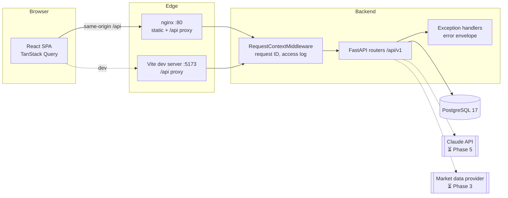
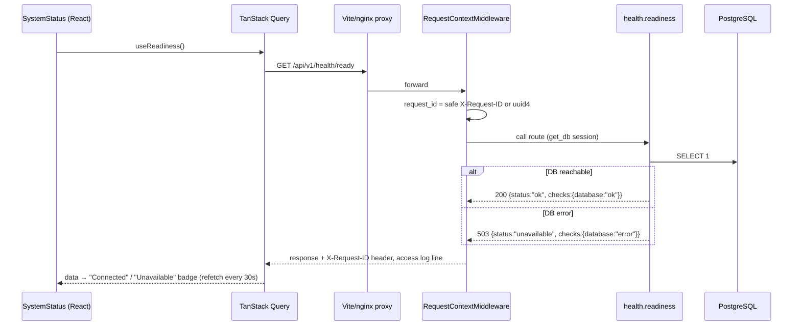
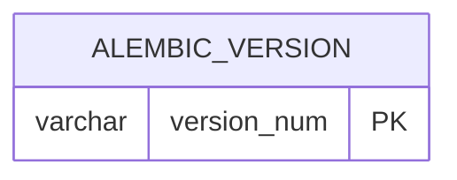

# FinSight — System Flow

> **Single source of truth for the system as actually implemented.**
> Anything not yet built is explicitly marked **Planned** with its target phase. If code and
> this document disagree, the code is wrong or this document is stale — fix one of them in the
> same change.

- Last updated: 2026-10-15 (Phase 2 — financial domain engine)
- Status legend: ✅ implemented & verified by tests · 🟡 implemented, not fully verified ·
  ⏳ planned (phase) · ❌ not started

---

## 1. Feature matrix

| # | Feature | Status | Phase | Verification |
|---|---------|--------|-------|--------------|
| F0 | Health checks (`/health/live`, `/health/ready`) | ✅ | 1 | `backend/tests/test_health.py`, `frontend/src/features/health/SystemStatus.test.tsx` |
| F0 | Uniform error envelope + request IDs + JSON logging | ✅ | 1 | `backend/tests/test_health.py` |
| F0 | Config via env, secrets masked | ✅ | 1 | `backend/tests/test_config.py` |
| F0 | Alembic migration chain (baseline) | ✅ | 1 | `backend/tests/test_migrations.py` — SQLite locally; PostgreSQL 17 in CI (16/16 passed, run 38623910065) |
| F0 | Docker images | ✅ | 1 | Both images build in CI `docker` job |
| F0 | Docker Compose stack (`up`) | 🟡 | 1 | `docker compose config` validated; full `up` not yet run (no local Docker daemon) |
| F0 | GitHub Actions CI | ✅ | 1 | Green on `main` and `dev/claude` (github.com/unknownMagician/finsight) |
| F1 | Company search & profiles | ⏳ | 3–4 | — |
| F2 | Statement domain models + ratio engine | ✅ engine · ⏳ API/UI (3–4) | 2 | `tests/domain/test_ratios.py`, `test_types_and_numeric.py` |
| F3 | DCF engine + WACC + sensitivity | ✅ engine · ⏳ API/UI (3–4) | 2 | `tests/domain/test_dcf.py`, `test_wacc.py` |
| F4 | Comparable company engine | ✅ engine · ⏳ API/UI (3–4) | 2 | `tests/domain/test_comps.py` |
| F5 | Forecast engine (bull/base/bear) | ✅ engine · ⏳ API/UI (3–4) | 2 | `tests/domain/test_forecast.py` |
| F6 | Annual report PDF upload & fact extraction | ⏳ | 5 | — |
| F7 | AI research assistant with citations | ⏳ | 5 | — |
| F8 | Research report generation & export | ⏳ | 6 | — |
| F9 | Watchlists & personalized dashboard | ⏳ | 3–4 | — |
| S1 | Authentication & resource-level authorization | ⏳ | 3 | — |
| S2 | Rate limiting | ⏳ | 3 | — |

---

## 2. Repository structure (actual)

```
.
├── CLAUDE.md                 # Working rules for AI agents in this repo
├── README.md                 # Setup & usage
├── SYSTEM_FLOW.md            # This document
├── docker-compose.yml        # db (Postgres 17) + backend + frontend (nginx)
├── .env.example              # Template; real .env is git-ignored
├── .github/workflows/ci.yml  # backend, frontend, docker jobs
├── backend/
│   ├── pyproject.toml        # deps + ruff/mypy/pytest config
│   ├── alembic.ini
│   ├── alembic/
│   │   ├── env.py            # reads URL from app settings
│   │   └── versions/0001_baseline.py
│   ├── app/
│   │   ├── main.py           # create_app(): middleware, handlers, routers
│   │   ├── core/
│   │   │   ├── config.py     # Settings (pydantic-settings, FINSIGHT_* env)
│   │   │   ├── logging.py    # JSON formatter, request_id context var
│   │   │   ├── middleware.py # RequestContextMiddleware (request ID + access log)
│   │   │   └── errors.py     # AppError + exception handlers → error envelope
│   │   ├── db/
│   │   │   ├── base.py       # DeclarativeBase with naming convention
│   │   │   └── session.py    # lazy engine/sessionmaker, get_db dependency
│   │   ├── models/__init__.py# model registry for Alembic (no tables yet)
│   │   ├── domain/           # PURE financial logic (no I/O; guarded by a test)
│   │   │   ├── types.py      # Scale, ValueKind, ReportingPeriod, SourceRef, Issue
│   │   │   ├── numeric.py    # mean / median / percentile on Decimal
│   │   │   ├── statements.py # Income/Balance/CashFlow + FinancialPeriodData
│   │   │   ├── ratios.py     # compute_ratios → RatioReport of MetricResult
│   │   │   ├── wacc.py       # compute_wacc (CAPM)
│   │   │   ├── dcf.py        # run_dcf, sensitivity, build_axis
│   │   │   ├── forecast.py   # project, run_scenarios (bull/base/bear)
│   │   │   └── comps.py      # analyze_comps (trading multiples)
│   │   └── api/health.py     # /health/live, /health/ready
│   ├── tests/                # pytest: health, config, migrations; tests/domain/ engine tests
│   └── Dockerfile
└── frontend/
    ├── package.json          # Vite + React 19 + TS + Tailwind 4 + Router 8 + TanStack Query 5
    ├── vite.config.ts        # dev proxy /api → backend; Vitest config
    ├── nginx.conf            # prod: static SPA + /api reverse proxy
    ├── Dockerfile
    └── src/
        ├── main.tsx          # QueryClientProvider + RouterProvider
        ├── app/              # routes, Layout, queryClient defaults
        ├── lib/api.ts        # apiFetch + ApiError (parses error envelope)
        ├── features/health/  # useLiveness/useReadiness hooks, SystemStatus card
        ├── pages/            # HomePage, NotFoundPage
        └── test/             # Vitest setup + render/fetch helpers
```

Planned additions (Phase 3+): `app/services/` (orchestration: load → domain → persist),
`app/providers/` (market data, Claude adapter), `app/schemas/` (API I/O), ORM tables in
`app/models/`.

---

## 3. Architecture



**Security boundary:** the browser only ever calls same-origin `/api/v1/*`. All secrets
(`FINSIGHT_DATABASE_URL`, `FINSIGHT_ANTHROPIC_API_KEY`, `FINSIGHT_JWT_SECRET`) live in the
backend process environment. The frontend bundle contains no credentials and no provider URLs.

---

## 4. Request flows

### 4.1 Health check (implemented)



- **Origin:** browser query on page load.
- **Validation:** none needed (no input). Response typed by `ReadinessResponse` (Pydantic) and
  mirrored by the TS interface in `frontend/src/features/health/api.ts`.
- **Functions:** `app.api.health.readiness` → `app.db.session.check_database`.
- **Tables:** none (connectivity probe only).
- **Note:** `useReadiness` treats 503 as a valid answer (reads the body) rather than an error.

### 4.2 Error flow (implemented)

1. Any exception raised inside a route is caught by a handler in `app/core/errors.py`:
   - `AppError` → its own `code`/`status_code`.
   - `HTTPException` (e.g. 404) → `code: "http_error"`.
   - `RequestValidationError` → 422, `code: "validation_error"`, `details: [{loc,msg,type}]`.
   - Any other `Exception` → logged with stack trace; client receives 500
     `code: "internal_error"` and a generic message (no internals).
2. Every envelope includes `request_id`, equal to the `X-Request-ID` response header.
   Unhandled 500s run in Starlette's outer `ServerErrorMiddleware`, so the middleware also
   stores the ID on `scope["state"]` for that handler to read.
3. Frontend `apiFetch` converts non-2xx into `ApiError{status, code, message, requestId, details}`;
   network failure → `status: 0, code: "network_error"`. TanStack Query does not retry 4xx.

---

## 5. API reference (implemented)

Base path: `/api/v1`. OpenAPI at `/openapi.json`, Swagger UI at `/docs` (disabled when
`FINSIGHT_ENVIRONMENT=production`).

| Method | Path | Auth | Response 200 | Other |
|--------|------|------|--------------|-------|
| GET | `/health/live` | none | `LivenessResponse {status:"ok", service, version, environment}` | — |
| GET | `/health/ready` | none | `ReadinessResponse {status:"ok", checks:{database:"ok"}}` | 503 same schema with `"unavailable"`/`"error"` |

Error envelope (all non-2xx):

```json
{"error": {"code": "validation_error", "message": "Request validation failed",
           "request_id": "6f1c…", "details": [{"loc": ["query","n"], "msg": "…", "type": "…"}]}}
```

---

## 6. Database

- Engine: PostgreSQL 17 (driver `psycopg` 3). Tests default to SQLite for speed; CI also runs
  the suite against a Postgres service via `TEST_DATABASE_URL`.
- Migrations: Alembic, linear chain, one head (enforced by `test_single_head`).
- Constraint naming convention defined in `app/db/base.py` for deterministic migrations.
- Drift guard: `test_models_match_migrations` fails if ORM models and migrations differ.

| Revision | Description | Tables |
|----------|-------------|--------|
| `0001` | Baseline — establishes the chain | *(none; only `alembic_version`)* |



Domain tables (users, companies, filings, statements, line items, valuations, documents,
chunks, watchlists, reports) are ⏳ planned for Phases 2–6 and will be documented here when
their migrations exist.

---

## 7. External financial data providers

⏳ Planned (Phase 3). No provider is integrated; **the system currently holds no market data or
financial statements.** Requirements for whichever provider is chosen: every stored figure
records source, retrieval timestamp, currency, unit/scale, and reporting period; missing values
are stored as missing (never zero-filled or invented).

## 8. Data ingestion & normalization

⏳ Planned (Phase 3).

## 9. Financial calculations (`backend/app/domain/`)

**Status:** pure engine implemented and unit-tested (Phase 2). Not yet exposed via API or
persisted (Phase 3), so no real company data flows through it yet.

### 9.1 Conventions (apply to every calculation)

- **Numbers:** `Decimal` everywhere; no floats. Non-finite values (NaN/±Inf) rejected.
  Full precision is kept; rounding is a presentation concern.
- **Rates:** fractions (`0.08` = 8%). **Multiples ("times")** are plain ratios.
- **Units:** each statement / DCF / forecast / comps object carries one `currency`
  (ISO 4217) and one `scale` (`units|thousands|millions|billions`). Cross-object arithmetic
  rescales via `types.rescale`; **different currencies are rejected** (FX conversion belongs
  to the data layer with a documented rate source).
- **Provenance:** `ValueKind` = `reported | calculated | assumption | forecast | ai_explanation`.
  Statements default to `reported`; ratio outputs are `calculated`; forecast outputs are
  `forecast`. Statements carry a `SourceRef` (provider, retrieved_at, url/document/page).
- **Missing data:** `None` = not reported; never treated as 0. Derived totals require all
  components (e.g. total debt needs both ST and LT debt unless total debt is reported).
- **Validation:** structural and assumption errors → `pydantic.ValidationError` (or
  `ValueError` for cross-object checks). Non-fatal concerns → `Issue{code, severity, message}`.
- **Immutability:** all domain models are frozen with `extra="forbid"`.
- **Purity:** `tests/domain/test_types_and_numeric.py` fails if any domain module imports
  I/O libraries (fastapi, sqlalchemy, httpx, requests, os, random, app.db).

### 9.2 Statement sign conventions (`statements.py`)

| Field group | Convention |
|---|---|
| revenue, profits, cash flows | natural sign (losses negative) |
| `interest_expense`, `capital_expenditures`, `dividends_paid`, `share_repurchases` | positive magnitude (≥ 0) |
| balance-sheet assets, liabilities, debt | ≥ 0 |
| `total_equity` | may be negative |
| `shares_outstanding`, `diluted_shares` | > 0 |

### 9.3 Ratios (`ratios.compute_ratios(data, prior=None) → RatioReport`)

Each metric is a `MetricResult{value, unit, kind, formula, inputs, status, missing, note}`
with `status ∈ ok | missing_inputs | not_meaningful`. Every division requires a **strictly
positive denominator**, otherwise `not_meaningful` (e.g. ROE with negative equity).

| Key | Formula | Unit |
|---|---|---|
| `gross_margin` | gross_profit ÷ revenue (gross_profit reported, else revenue − cost_of_revenue) | ratio |
| `operating_margin` | operating_income ÷ revenue | ratio |
| `ebitda` | operating_income + depreciation_amortization | currency |
| `ebitda_margin` | ebitda ÷ revenue | ratio |
| `net_margin` | net_income ÷ revenue | ratio |
| `effective_tax_rate` | income_tax_expense ÷ pretax_income | ratio |
| `return_on_equity` | net_income ÷ avg(total_equity)* | ratio |
| `return_on_assets` | net_income ÷ avg(total_assets)* | ratio |
| `asset_turnover` | revenue ÷ avg(total_assets)* | times |
| `current_ratio` | total_current_assets ÷ total_current_liabilities | times |
| `quick_ratio` | (total_current_assets − inventory) ÷ total_current_liabilities | times |
| `total_debt` | reported total_debt, else short_term_debt + long_term_debt | currency |
| `debt_to_equity` | total_debt ÷ total_equity | times |
| `net_debt` | total_debt − cash_and_equivalents | currency |
| `net_debt_to_ebitda` | net_debt ÷ ebitda | times |
| `interest_coverage` | operating_income ÷ interest_expense | times |
| `free_cash_flow` | operating_cash_flow − capital_expenditures | currency |
| `fcf_margin` | free_cash_flow ÷ revenue | ratio |
| `revenue_growth` | revenue ÷ prior_revenue − 1 (only with `prior`) | ratio |

\* With `prior`: average of opening (prior, rescaled) and closing balance. Without `prior`:
ending balance, stated in `note`. `prior` must be the same company and currency and must end
before the current period.

### 9.4 WACC (`wacc.compute_wacc`)

```
cost_of_equity         = risk_free_rate + beta × equity_risk_premium + size_premium
after_tax_cost_of_debt = pre_tax_cost_of_debt × (1 − tax_rate)
wacc                   = E/(D+E) × cost_of_equity + D/(D+E) × after_tax_cost_of_debt
```

Bounds: rf ∈ [−5%, 25%], ERP ∈ [0, 25%], beta ∈ [−2, 5], size premium ∈ [0, 15%],
Kd ∈ [0, 50%], tax ∈ [0, 100%), E > 0, D ≥ 0. Result must be > 0 (else error). Warnings:
`equity_cheaper_than_debt`, `unusual_wacc` (outside 4–20%). Weights should be market values.

### 9.5 Forecast (`forecast.project`, `forecast.run_scenarios`)

```
revenue_t = revenue_{t−1} × (1 + revenue_growth_t)
ebit_t    = revenue_t × ebit_margin_t
taxes_t   = max(ebit_t, 0) × tax_rate            (no tax credit on losses)
nopat_t   = ebit_t − taxes_t
d_and_a_t = revenue_t × da_pct_revenue
capex_t   = revenue_t × capex_pct_revenue
nwc_t     = revenue_t × nwc_pct_revenue
Δnwc_t    = nwc_t − nwc_{t−1}   (nwc_0 = base_nwc, else base_revenue × nwc_pct, recorded in notes)
fcf_t     = nopat_t + d_and_a_t − capex_t − Δnwc_t
```

Validation: 1–30 years; growth ∈ (−100%, 500%]; margins ∈ [−100%, 100%]; tax ∈ [0, 100%);
D&A and capex ∈ [0, 100%] of revenue; NWC ∈ [−100%, 100%]; growth and margin lists equal
length. Scenarios `bull | base | bear`: base required, one shared horizon. Warnings
`bull_below_base`, `bear_above_base` (final-year revenue). Outputs are `ValueKind.forecast`.

### 9.6 Comparable companies (`comps.analyze_comps`)

| Multiple | Formula |
|---|---|
| `ev_revenue` | EV ÷ revenue |
| `ev_ebitda` | EV ÷ EBITDA |
| `price_earnings` | market_cap ÷ net_income |
| `price_book` | market_cap ÷ book_equity |

EV = reported `enterprise_value`, else `market_cap + net_debt + other_claims` (requires
`net_debt`). Peers are rescaled to the target's scale; mixed currencies, duplicate peers, or
an empty peer list are rejected. A peer is **excluded with a recorded reason** for a multiple
when an input is missing, the denominator ≤ 0, or it is the target itself. Stats per multiple:
count, min, p25, median, mean, p75, max (percentiles use linear interpolation, numpy default).

Implied target value at the peer **median** (low/high at p25/p75): EV multiples →
`implied_ev = multiple × target_metric`, `equity = implied_ev − net_debt − other_claims`;
equity multiples → `equity = multiple × target_metric`; `per_share = equity ÷
shares_outstanding` (None if equity ≤ 0 or shares missing). Not applicable (with note) when the
target metric is missing or ≤ 0, or `net_debt` is missing for the EV bridge. Warning
`few_peers` when fewer than 3 usable peers.

## 10. DCF valuation & sensitivity (`dcf.run_dcf`, `dcf.sensitivity`)

Unlevered FCF (FCFF) DCF. Inputs (`DCFInputs`): `free_cash_flows` (1–30 years), `wacc`,
`terminal_method`, `terminal_growth` | (`exit_multiple` + `terminal_ebitda`),
`mid_year_convention`, `net_debt` (negative = net cash), `other_claims` (minority +
preferred, ≥ 0), `shares_outstanding` (> 0), `currency`, `scale`.

```
discount_period_t = t   (t − 0.5 with mid-year convention)
PV_t              = FCF_t / (1 + wacc)^discount_period_t
TV (perpetuity)   = FCF_N × (1 + g) / (wacc − g)
TV (exit)         = terminal_ebitda × exit_multiple
PV(TV)            = TV / (1 + wacc)^N         (end of year N under both conventions)
EV                = Σ PV_t + PV(TV)
equity            = EV − net_debt − other_claims
per_share         = equity / shares           (None when equity ≤ 0)
tv_share          = PV(TV) / EV
implied multiple  = TV / terminal_ebitda                  (perpetuity method, if EBITDA given)
implied growth    = (TV × wacc − FCF_N) / (TV + FCF_N)    (exit method)
```

**Hard validation (input rejected):** 0 < wacc < 1. Perpetuity method: requires `g`, forbids
`exit_multiple`, **g < wacc**, g ∈ (−50%, 50%), FCF_N × (1 + g) > 0. Exit method: requires
`exit_multiple` ∈ (0, 100] and `terminal_ebitda`, forbids `g`. `terminal_ebitda` > 0.

**Warnings (result still returned):** `high_terminal_growth` (g > 4%),
`terminal_growth_near_wacc` (wacc − g < 2pp), `unusual_wacc` (outside 4–20%),
`exit_multiple_implies_high_growth` (> 4%), `terminal_value_dominant` (PV(TV) > 75% of EV),
`non_positive_enterprise_value`, `non_positive_equity_value`, `negative_fcf_years` (info).

**Sensitivity:** `sensitivity(inputs, wacc_values, column_values, output)` re-validates and
re-runs the DCF for each WACC × (terminal growth | exit multiple) cell; `output` is
`value_per_share | enterprise_value | equity_value`. Invalid cells (e.g. g ≥ wacc) are `None`
with the reason in `invalid_reasons["row,col"]`. Each axis ≤ 15 values;
`build_axis(center, step, count)` builds symmetric odd-length axes.

**Verified example** (`test_perpetuity_growth_hand_computed`): FCF 100/110/121, wacc 10%,
g 2%, net debt 200, 10 shares → EV = 15750/11 ≈ 1431.82, equity ≈ 1231.82, ≈ 123.18/share,
TV share = 17/21 ≈ 81% (flagged `terminal_value_dominant`).

## 11. PDF upload, extraction, chunking, retrieval

⏳ Planned (Phase 5). nginx already caps request bodies at 25 MB for `/api/`.

## 12. AI prompting, retrieval, citation validation

⏳ Planned (Phase 5). The Claude API key is a backend-only setting
(`FINSIGHT_ANTHROPIC_API_KEY`); all model calls will go through a backend provider adapter.

## 13. Authentication, authorization, security

Implemented:
- Secrets read only from backend env (`Settings`), typed `SecretStr` (masked in repr/logs).
- `.env` git-ignored; `.env.example` contains placeholders only.
- CORS allow-list from `FINSIGHT_CORS_ORIGINS` (explicit methods/headers).
- Client-supplied `X-Request-ID` accepted only if it matches `^[A-Za-z0-9._-]{1,64}$`
  (prevents log injection); otherwise a new UUID is generated.
- 500 responses never include exception text.
- OpenAPI/docs disabled in production.
- nginx adds `X-Content-Type-Options`, `X-Frame-Options`, `Referrer-Policy`.
- Compose binds ports to `127.0.0.1` and requires `POSTGRES_PASSWORD`.
- Backend container runs as non-root user `finsight` (uid 10001).

⏳ Planned (Phase 3): user accounts, password hashing, JWT/session auth, per-resource ownership
checks, rate limiting.

## 14. Error handling, logging, retries, background jobs

- **Logging:** `app/core/logging.py` — one JSON object per line on stdout
  (`ts, level, logger, msg, request_id, …extra`). Access log line per request with
  `method, path, status, duration_ms`. Toggle with `FINSIGHT_LOG_JSON`.
- **Errors:** see §4.2.
- **Retries:** frontend TanStack Query retries non-4xx failures up to 2 times. No backend retries
  yet (no outbound calls exist).
- **Background jobs:** none yet.

## 15. Deployment & testing workflows

| Workflow | Command | Where |
|----------|---------|-------|
| Backend tests | `pytest` (in `backend/`) | local (SQLite), CI (Postgres) |
| Backend lint/format/types | `ruff check .`, `ruff format --check .`, `mypy` | local, CI |
| Frontend tests | `npm test` (Vitest + RTL, jsdom) | local, CI |
| Frontend lint/build | `npm run lint`, `npm run build` (includes `tsc`) | local, CI |
| Full stack | `docker compose up --build` | local |
| Image builds | `docker build ./backend`, `docker build ./frontend` | CI `docker` job |
| E2E (Playwright) | ⏳ Phase 4 | — |

Container start-up: backend runs `alembic upgrade head` then `uvicorn`. Compose waits for
`db` healthy → `backend` healthy (`/health/ready`) → `frontend`.
