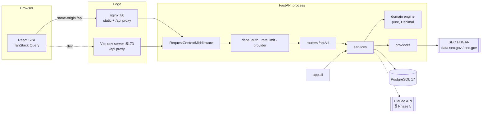
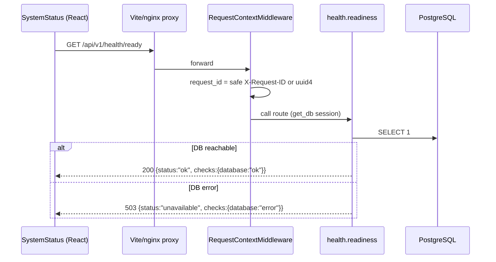
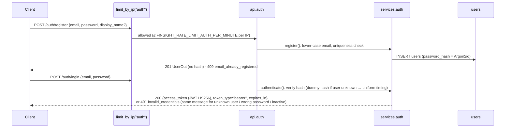
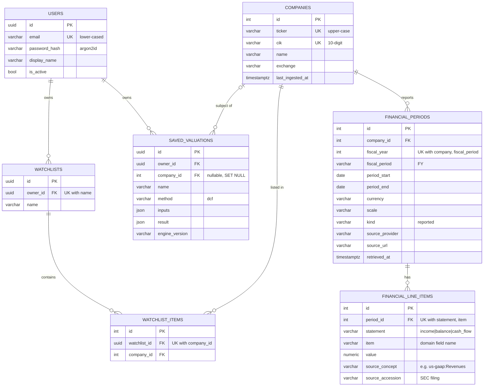

# FinSight — System Flow

> **Single source of truth for the system as actually implemented.**
> Anything not yet built is explicitly marked **Planned** with its target phase. If code and
> this document disagree, the code is wrong or this document is stale — fix one of them in the
> same change.

- Last updated: 2026-10-15 (Phase 3 — APIs, auth, persistence, SEC EDGAR ingestion)
- Status legend: ✅ implemented & verified by tests · 🟡 implemented, not fully verified ·
  ⏳ planned (phase) · ❌ not started

---

## 1. Feature matrix

| # | Feature | Status | Phase | Verification |
|---|---------|--------|-------|--------------|
| F0 | Health checks (`/health/live`, `/health/ready`) | ✅ | 1 | `backend/tests/test_health.py`, `frontend/src/features/health/SystemStatus.test.tsx` |
| F0 | Uniform error envelope + request IDs + JSON logging | ✅ | 1 | `backend/tests/test_health.py` |
| F0 | Config via env, secrets masked, blank = unset | ✅ | 1, 3 | `backend/tests/test_config.py` |
| F0 | Alembic migrations (0001 baseline, 0002 core tables) | ✅ SQLite · CI Postgres | 1, 3 | `tests/test_migrations.py` (round-trip, drift guard); every API test migrates up/down |
| F0 | Docker images | ✅ | 1 | Both images build in CI `docker` job |
| F0 | Docker Compose stack (`up`) | 🟡 | 1 | `docker compose config` validated; full `up` not yet run (no local Docker daemon) |
| F0 | GitHub Actions CI | ✅ | 1 | Green on `main` and `dev/claude` |
| F1 | Company directory, search, profile API | ✅ API · ⏳ UI (4) | 3 | `tests/test_companies_api.py` |
| F1 | SEC EDGAR ingestion (annual 10-K, US-GAAP) | ✅ API/CLI · ⏳ UI (4) | 3 | `tests/test_edgar.py` (synthetic fixture + mocked HTTP); manual live smoke test 2026-10-15: AAPL/MSFT/JPM, AAPL FY2024 figures matched the 10-K |
| F2 | Statement models + ratio engine | ✅ engine · ✅ API · ⏳ UI (4) | 2, 3 | `tests/domain/test_ratios.py`, `tests/test_companies_api.py` |
| F3 | DCF + WACC + sensitivity | ✅ engine · ✅ API · ⏳ UI (4) | 2, 3 | `tests/domain/test_dcf.py`, `test_wacc.py`, `tests/test_calculations_api.py` |
| F4 | Comparable companies | ✅ engine · ✅ API (user-supplied peer metrics) · ⏳ UI (4) | 2, 3 | `tests/domain/test_comps.py`, `tests/test_calculations_api.py` |
| F5 | Forecast (bull/base/bear) | ✅ engine · ✅ API · ⏳ UI (4) | 2, 3 | `tests/domain/test_forecast.py`, `tests/test_calculations_api.py` |
| F5 | Saved DCF valuations (owner-scoped) | ✅ API · ⏳ UI (4) | 3 | `tests/test_valuations_api.py` |
| F6 | Annual report PDF upload & fact extraction | ⏳ | 5 | — |
| F7 | AI research assistant with citations | ⏳ | 5 | — |
| F8 | Research report generation & export | ⏳ | 6 | — |
| F9 | Watchlists (owner-scoped CRUD) | ✅ API · ⏳ UI/dashboard (4) | 3 | `tests/test_watchlists_api.py` |
| S1 | Authentication (Argon2id + JWT) & resource-level authorization | ✅ | 3 | `tests/test_auth_api.py`, `test_security.py`, cross-user tests in watchlist/valuation suites |
| S2 | Rate limiting (in-process) | ✅ single process · ⏳ shared store for multi-replica | 3 | `tests/test_security.py`, `test_auth_api.py`, `test_calculations_api.py` |
| — | Market prices / market cap feed | ❌ | — | Not integrated: no live price data exists in the system. Comps and DCF take market inputs from the user. |

---

## 2. Repository structure (actual)

```
.
├── CLAUDE.md                 # Working rules for AI agents in this repo
├── README.md                 # Setup & usage
├── SYSTEM_FLOW.md            # This document
├── docker-compose.yml        # db (Postgres 17) + backend + frontend (nginx)
├── .env.example              # Template; real .env is git-ignored
├── .github/workflows/ci.yml  # backend, frontend, docker jobs
├── backend/
│   ├── pyproject.toml        # deps + ruff/mypy/pytest config
│   ├── alembic.ini
│   ├── alembic/
│   │   ├── env.py            # reads URL from app settings
│   │   └── versions/         # 0001_baseline.py, 0002_core_tables.py
│   ├── app/
│   │   ├── main.py           # create_app(): middleware, handlers, rate limiter, routers
│   │   ├── cli.py            # python -m app.cli sync-companies | ingest TICKER...
│   │   ├── schemas.py        # API request/response models (transport layer)
│   │   ├── core/
│   │   │   ├── config.py     # Settings (pydantic-settings, FINSIGHT_* env)
│   │   │   ├── logging.py    # JSON formatter, request_id context var
│   │   │   ├── middleware.py # RequestContextMiddleware (request ID + access log)
│   │   │   ├── errors.py     # AppError(code, message, status, details, headers) → envelope
│   │   │   ├── security.py   # Argon2id hashing, JWT create/decode, secret validation
│   │   │   └── ratelimit.py  # in-process sliding-window RateLimiter
│   │   ├── db/
│   │   │   ├── base.py       # DeclarativeBase with naming convention
│   │   │   └── session.py    # lazy engine/sessionmaker, get_db dependency
│   │   ├── models/           # ORM: user, company (+ periods, line items), watchlist, valuation
│   │   ├── domain/           # PURE financial logic (no I/O; guarded by a test) — see §9–10
│   │   ├── providers/
│   │   │   ├── base.py       # FinancialDataProvider protocol + DTOs + ProviderError
│   │   │   ├── edgar_normalize.py # pure: companyfacts JSON → annual line items
│   │   │   └── sec_edgar.py  # HTTP client: directory, companyfacts, retries
│   │   ├── services/         # auth, companies (ingest/ratios), watchlists, valuations
│   │   └── api/
│   │       ├── deps.py       # DbSession, CurrentUser, rate-limit deps, Provider
│   │       ├── health.py, auth.py, companies.py, calculations.py,
│   │       └── watchlists.py, valuations.py
│   ├── tests/                # API/integration tests; tests/domain/ engine tests;
│   │                         # fakes.py (FakeProvider), fixtures_edgar.py (SYNTHETIC data)
│   └── Dockerfile
└── frontend/                 # unchanged since Phase 1 (UI work is Phase 4)
    ├── vite.config.ts, nginx.conf, Dockerfile
    └── src/ (app/, lib/api.ts, features/health/, pages/, test/)
```

Layering rule: `api` → `services` → (`models`, `providers`, `domain`). `domain` imports nothing
from the other layers. `providers` return DTOs, never ORM objects.

---

## 3. Architecture



**Security boundary:** the browser only ever calls same-origin `/api/v1/*`. All secrets
(`FINSIGHT_DATABASE_URL`, `FINSIGHT_JWT_SECRET`, `FINSIGHT_ANTHROPIC_API_KEY`) and the SEC
User-Agent live in the backend process environment. The frontend bundle contains no
credentials and no provider URLs. Only the backend talks to SEC EDGAR.

---

## 4. Request flows

### 4.1 Health check



Functions: `api.health.readiness` → `db.session.check_database`. Tables: none. The frontend
treats 503 as a valid "not ready" answer.

### 4.2 Error flow

1. Exceptions inside a route are handled in `app/core/errors.py`:
   `AppError` → its `code`/`status_code`/`headers`; `HTTPException` → `http_error`;
   `RequestValidationError` → 422 `validation_error` with `details: [{loc,msg,type}]`
   (input values are **not** echoed back); anything else → logged with stack trace, client gets
   500 `internal_error` with a generic message.
2. Every envelope carries `request_id` = the `X-Request-ID` header (also for 500s, via
   `scope["state"]`).
3. Frontend `apiFetch` maps non-2xx to `ApiError{status, code, message, requestId, details}`.

### 4.3 Registration and login



Subsequent requests send `Authorization: Bearer <token>`. `deps.get_current_user` decodes the
token (`exp`, `iat`, `sub` required, `type == "access"`, algorithm pinned to HS256), loads the
user, and rejects missing/inactive users with 401 `not_authenticated` + `WWW-Authenticate:
Bearer`.

### 4.4 Ingest a company's annual financials

```mermaid
sequenceDiagram
    participant C as Client (authenticated)
    participant RL as limit_by_user("ingest")
    participant R as api.companies.ingest_company
    participant S as services.companies.ingest
    participant P as SecEdgarProvider
    participant SEC as SEC EDGAR
    participant N as edgar_normalize (pure)
    participant DB as companies / financial_periods / financial_line_items
    C->>RL: POST /companies/{ticker}/ingest
    RL->>R: ≤ FINSIGHT_RATE_LIMIT_INGEST_PER_HOUR per user
    R->>S: ingest(db, provider, ticker)
    S->>P: lookup(ticker)
    P->>SEC: GET sec.gov/files/company_tickers_exchange.json (cached 24h)
    S->>P: fetch_annual_financials(listing)
    P->>SEC: GET data.sec.gov/api/xbrl/companyfacts/CIK##########.json (retries)
    P->>N: normalize_companyfacts(doc)
    N-->>P: periods[] of line items (+ concept, accession) and warnings
    P-->>S: IngestionResult(provider, source_url, retrieved_at, periods, warnings)
    S->>DB: upsert company; per (fiscal_year, FY): upsert period, replace its line items
    S-->>C: 200 {company, periods_ingested, fiscal_years, warnings}
```

- **Origin:** SEC EDGAR public XBRL API (data as filed by the company).
- **Validation/transformation:** see §8. Values violating domain sign conventions are dropped
  and reported in `warnings`; nothing is derived or estimated at ingest time.
- **Errors:** unknown ticker → 404 `company_not_found`; provider down/5xx/malformed → 502
  `provider_unavailable` (provider details logged, not returned); `FINSIGHT_SEC_USER_AGENT`
  unset → 503 `provider_not_configured`.
- **Idempotency:** re-ingesting replaces a period's line items; it never duplicates them.
- **Synchronous:** runs inside the request (one or two HTTP calls, 15 s timeout each). No
  background job queue exists yet.

### 4.5 Ratios for a stored company

`GET /companies/{ticker}/ratios?fiscal_year=` → `services.companies.ratios` loads FY periods
(`financial_periods` + `financial_line_items`), picks the requested year (default latest) and
`fiscal_year − 1` as prior if stored, converts both with `to_domain()` into
`FinancialPeriodData` (re-validated by the domain models), and returns
`domain.ratios.compute_ratios(...)` → `RatioReport` (each metric with formula, inputs, status).
404 `no_financial_data` if the year is not stored.

### 4.6 Calculators and saved valuations

`POST /calculations/{wacc|dcf|dcf/sensitivity|forecast|comps}`: the request body **is** the
domain input model (validated by Pydantic, including `g < WACC` etc.); the route calls the pure
engine and returns the domain result. Cross-object rule violations (e.g. mixed peer
currencies, missing base scenario) → 422 `invalid_assumptions`. Nothing is persisted.

`POST /valuations {name, ticker?, inputs: DCFInputs}` re-runs `run_dcf` **server-side** and
stores `inputs` and `result` as JSON (Decimals as strings) with `engine_version`. Clients cannot
submit a result (`extra="forbid"` → 422).

### 4.7 Watchlists

`/watchlists` CRUD and `/watchlists/{id}/items` add/remove by ticker (company must already be
stored, else 404 `company_not_found`). Every query filters by `owner_id = current_user.id`; a
watchlist owned by someone else is indistinguishable from a missing one (404).

---

## 5. API reference

Base path `/api/v1`. OpenAPI at `/openapi.json`, Swagger UI at `/docs` (both disabled when
`FINSIGHT_ENVIRONMENT=production`). All amounts in responses are **JSON strings** (exact
decimals); requests may send numbers or strings. "Auth" = Bearer token required.

| Method | Path | Auth | Rate limit | Request | Response |
|---|---|---|---|---|---|
| GET | `/health/live` | — | — | — | `LivenessResponse` |
| GET | `/health/ready` | — | — | — | `ReadinessResponse` (200/503) |
| POST | `/auth/register` | — | auth/IP | `RegisterRequest {email, password (12–128), display_name?}` | 201 `UserOut`; 409 |
| POST | `/auth/login` | — | auth/IP | `LoginRequest {email, password}` | `TokenResponse`; 401 |
| GET | `/auth/me` | ✓ | — | — | `UserOut` |
| GET | `/companies?q=&limit=` | ✓ | — | q 1–100 chars, limit 1–50 | `CompanyOut[]` (exact ticker, then ticker prefix, then name) |
| GET | `/companies/{ticker}` | ✓ | — | — | `CompanyOut`; 404 |
| POST | `/companies/{ticker}/ingest` | ✓ | ingest/user | — | `IngestOut`; 404/502/503 |
| GET | `/companies/{ticker}/financials` | ✓ | — | — | `FinancialsOut {company, periods[{…, source, line_items[{statement,item,value,source_concept,source_accession}]}]}` |
| GET | `/companies/{ticker}/ratios?fiscal_year=` | ✓ | — | — | `RatioReport`; 404 |
| POST | `/calculations/wacc` | ✓ | compute/user | `WACCInputs` | `WACCResult` |
| POST | `/calculations/dcf` | ✓ | compute/user | `DCFInputs` | `DCFResult` |
| POST | `/calculations/dcf/sensitivity` | ✓ | compute/user | `{inputs, wacc_values[≤15], column_values[≤15], output}` | `SensitivityTable` |
| POST | `/calculations/forecast` | ✓ | compute/user | `{base: ForecastBase, scenarios: {bull?, base, bear?}}` | `ScenarioSetResult` |
| POST | `/calculations/comps` | ✓ | compute/user | `{target, peers[1–50], multiples[]}` | `CompsResult` |
| GET | `/watchlists` | ✓ | — | — | `WatchlistOut[]` |
| POST | `/watchlists` | ✓ | — | `{name}` | 201 `WatchlistOut`; 409 name taken / limit |
| GET/PATCH/DELETE | `/watchlists/{id}` | ✓ owner | — | PATCH `{name}` | `WatchlistOut` / 204; 404 |
| POST | `/watchlists/{id}/items` | ✓ owner | — | `{ticker}` | `WatchlistOut` (idempotent) |
| DELETE | `/watchlists/{id}/items/{ticker}` | ✓ owner | — | — | `WatchlistOut`; 404 |
| GET | `/valuations` | ✓ | — | — | `SavedValuationOut[]` (newest first) |
| POST | `/valuations` | ✓ | compute/user | `{name, ticker?, inputs: DCFInputs}` | 201 `SavedValuationOut` |
| GET/DELETE | `/valuations/{id}` | ✓ owner | — | — | `SavedValuationOut` / 204; 404 |

Schemas live in `app/schemas.py` (transport) and `app/domain/*` (calculator I/O). Per-user
limits: 20 watchlists, 100 companies per watchlist, 200 saved valuations.

Error envelope (all non-2xx):

```json
{"error": {"code": "validation_error", "message": "Request validation failed",
           "request_id": "6f1c…", "details": [{"loc": ["body","wacc"], "msg": "…", "type": "…"}]}}
```

Error codes: `validation_error`, `invalid_assumptions`, `not_authenticated`,
`invalid_credentials`, `email_already_registered`, `rate_limited` (+ `Retry-After`),
`not_found`, `company_not_found`, `no_financial_data`, `watchlist_name_taken`,
`limit_exceeded`, `provider_unavailable`, `provider_not_configured`, `http_error`,
`internal_error`.

---

## 6. Database

- PostgreSQL 17 (psycopg 3). Tests use SQLite by default; CI runs the full suite on Postgres.
- Alembic, linear chain, single head; every API test upgrades to head and downgrades to base.
- Drift guard `test_models_match_migrations`; naming convention in `app/db/base.py`.
- Amounts: `NUMERIC(28, 6)`. Timestamps: `timestamptz`, server default `now()`.

| Revision | Description |
|---|---|
| `0001` | Baseline (no tables) |
| `0002` | users, companies, financial_periods, financial_line_items, watchlists, watchlist_items, saved_valuations |



Deletes cascade from users → watchlists/valuations, companies → periods → line items, and
watchlists → items. User-facing resources use UUID keys (no enumerable IDs).

---

## 7. External financial data providers

| Provider | Status | Data | Access |
|---|---|---|---|
| SEC EDGAR (`app/providers/sec_edgar.py`) | ✅ | Company directory (`company_tickers_exchange.json`), XBRL companyfacts (annual 10-K / 10-K/A, US-GAAP, USD) | Public; requires `FINSIGHT_SEC_USER_AGENT` with contact info (SEC fair-access policy, < 10 req/s) |
| Market prices / market cap | ❌ | — | None. The system has **no** price data; DCF/comps market inputs come from the user. |

Client behaviour: 15 s timeout (`FINSIGHT_SEC_TIMEOUT_SECONDS`); retries up to 3 times on
429/500/502/503/504 and transport errors with exponential backoff 0.5 s, 1 s, 2 s (or
`Retry-After`, capped at 10 s); 404 → `ProviderNotFoundError`; other 4xx / malformed JSON →
`ProviderError`. Redirects are not followed. The directory is cached in-process for 24 h.

The provider sits behind the `FinancialDataProvider` protocol (`lookup`, `list_companies`,
`fetch_annual_financials`), so another source can be added without touching services or API.

## 8. Data ingestion & normalization (`app/providers/edgar_normalize.py`)

Pure function `normalize_companyfacts(doc, max_years=10)`:

1. **Scope:** `facts["us-gaap"]` only; facts with `form ∈ {10-K, 10-K/A}` and `fp == "FY"`.
   Foreign filers (20-F, IFRS) and quarterly data are not ingested yet.
2. **Fiscal periods:** for each filing (accession), the period end is the latest `end` among its
   full-year duration facts, labelled with that filing's `fy`. Prior-year comparatives inside a
   10-K therefore never create mislabelled periods. Later filings win ties (amendments).
3. **Durations vs instants:** income and cash-flow items must span 350–380 days (52/53-week
   years; quarter-only facts inside a 10-K are ignored). Balance-sheet items are instants at the
   period end.
4. **Concept mapping:** each domain field has an ordered list of US-GAAP concepts (e.g. revenue:
   `RevenueFromContractWithCustomerExcludingAssessedTax` → `Revenues` → `SalesRevenueNet` → …;
   full table in `MAPPINGS`). First concept with a value for that period wins; units must be
   `USD` (`shares` for share counts, `USD/shares` for EPS).
5. **Restatements:** if several filings report the same concept/period, the most recently filed
   value wins and its accession number is stored with the line item.
6. **Validation:** each statement is validated by its domain model; values that break sign
   conventions (e.g. negative capex) are **dropped with a warning**, never coerced.
7. **No invention:** absent concepts give absent fields. Nothing is derived at ingest
   (e.g. gross profit is only stored if reported; the ratio engine derives it transparently).
8. Output periods: newest first, at most `max_years`, one per fiscal year; currency `USD`,
   scale `units`, kind `reported`.

**Known gaps found on live data (2026-10-15 smoke test):**
- Companies that report short-term debt only as `CommercialPaper` + `LongTermDebtCurrent`
  (e.g. AAPL) have no `short_term_debt`, so `total_debt`/`net_debt` are `missing_inputs`.
- Banks (e.g. JPM) do not report `GrossProfit`/`OperatingIncomeLoss`; margin-type ratios are
  `missing_inputs`. Industry-specific mappings are future work.

Operational CLI: `python -m app.cli sync-companies` (loads ~10k directory rows into
`companies` so search works before ingestion) and `python -m app.cli ingest AAPL MSFT …`.

## 9. Financial calculations (`backend/app/domain/`)

**Status:** pure engine (Phase 2), exposed via `/calculations/*` and `/companies/{ticker}/ratios`
(Phase 3). Ratios run on stored SEC EDGAR data; DCF/forecast/comps run on user-supplied inputs.

### 9.1 Conventions (apply to every calculation)

- **Numbers:** `Decimal` everywhere; no floats. Non-finite values (NaN/±Inf) rejected.
  Full precision is kept; rounding is a presentation concern.
- **Rates:** fractions (`0.08` = 8%). **Multiples ("times")** are plain ratios.
- **Units:** each statement / DCF / forecast / comps object carries one `currency`
  (ISO 4217) and one `scale` (`units|thousands|millions|billions`). Cross-object arithmetic
  rescales via `types.rescale`; **different currencies are rejected** (FX conversion belongs
  to the data layer with a documented rate source).
- **Provenance:** `ValueKind` = `reported | calculated | assumption | forecast | ai_explanation`.
  Statements default to `reported`; ratio outputs are `calculated`; forecast outputs are
  `forecast`. Statements carry a `SourceRef` (provider, retrieved_at, url/document/page).
- **Missing data:** `None` = not reported; never treated as 0. Derived totals require all
  components (e.g. total debt needs both ST and LT debt unless total debt is reported).
- **Validation:** structural and assumption errors → `pydantic.ValidationError` (or
  `ValueError` for cross-object checks). Non-fatal concerns → `Issue{code, severity, message}`.
- **Immutability:** all domain models are frozen with `extra="forbid"`.
- **Purity:** `tests/domain/test_types_and_numeric.py` fails if any domain module imports
  I/O libraries (fastapi, sqlalchemy, httpx, requests, os, random, app.db).

### 9.2 Statement sign conventions (`statements.py`)

| Field group | Convention |
|---|---|
| revenue, profits, cash flows | natural sign (losses negative) |
| `interest_expense`, `capital_expenditures`, `dividends_paid`, `share_repurchases` | positive magnitude (≥ 0) |
| balance-sheet assets, liabilities, debt | ≥ 0 |
| `total_equity` | may be negative |
| `shares_outstanding`, `diluted_shares` | > 0 |

### 9.3 Ratios (`ratios.compute_ratios(data, prior=None) → RatioReport`)

Each metric is a `MetricResult{value, unit, kind, formula, inputs, status, missing, note}`
with `status ∈ ok | missing_inputs | not_meaningful`. Every division requires a **strictly
positive denominator**, otherwise `not_meaningful` (e.g. ROE with negative equity).

| Key | Formula | Unit |
|---|---|---|
| `gross_margin` | gross_profit ÷ revenue (gross_profit reported, else revenue − cost_of_revenue) | ratio |
| `operating_margin` | operating_income ÷ revenue | ratio |
| `ebitda` | operating_income + depreciation_amortization | currency |
| `ebitda_margin` | ebitda ÷ revenue | ratio |
| `net_margin` | net_income ÷ revenue | ratio |
| `effective_tax_rate` | income_tax_expense ÷ pretax_income | ratio |
| `return_on_equity` | net_income ÷ avg(total_equity)* | ratio |
| `return_on_assets` | net_income ÷ avg(total_assets)* | ratio |
| `asset_turnover` | revenue ÷ avg(total_assets)* | times |
| `current_ratio` | total_current_assets ÷ total_current_liabilities | times |
| `quick_ratio` | (total_current_assets − inventory) ÷ total_current_liabilities | times |
| `total_debt` | reported total_debt, else short_term_debt + long_term_debt | currency |
| `debt_to_equity` | total_debt ÷ total_equity | times |
| `net_debt` | total_debt − cash_and_equivalents | currency |
| `net_debt_to_ebitda` | net_debt ÷ ebitda | times |
| `interest_coverage` | operating_income ÷ interest_expense | times |
| `free_cash_flow` | operating_cash_flow − capital_expenditures | currency |
| `fcf_margin` | free_cash_flow ÷ revenue | ratio |
| `revenue_growth` | revenue ÷ prior_revenue − 1 (only with `prior`) | ratio |

\* With `prior`: average of opening (prior, rescaled) and closing balance. Without `prior`:
ending balance, stated in `note`. `prior` must be the same company and currency and must end
before the current period.

### 9.4 WACC (`wacc.compute_wacc`)

```
cost_of_equity         = risk_free_rate + beta × equity_risk_premium + size_premium
after_tax_cost_of_debt = pre_tax_cost_of_debt × (1 − tax_rate)
wacc                   = E/(D+E) × cost_of_equity + D/(D+E) × after_tax_cost_of_debt
```

Bounds: rf ∈ [−5%, 25%], ERP ∈ [0, 25%], beta ∈ [−2, 5], size premium ∈ [0, 15%],
Kd ∈ [0, 50%], tax ∈ [0, 100%), E > 0, D ≥ 0. Result must be > 0 (else error). Warnings:
`equity_cheaper_than_debt`, `unusual_wacc` (outside 4–20%). Weights should be market values.

### 9.5 Forecast (`forecast.project`, `forecast.run_scenarios`)

```
revenue_t = revenue_{t−1} × (1 + revenue_growth_t)
ebit_t    = revenue_t × ebit_margin_t
taxes_t   = max(ebit_t, 0) × tax_rate            (no tax credit on losses)
nopat_t   = ebit_t − taxes_t
d_and_a_t = revenue_t × da_pct_revenue
capex_t   = revenue_t × capex_pct_revenue
nwc_t     = revenue_t × nwc_pct_revenue
Δnwc_t    = nwc_t − nwc_{t−1}   (nwc_0 = base_nwc, else base_revenue × nwc_pct, recorded in notes)
fcf_t     = nopat_t + d_and_a_t − capex_t − Δnwc_t
```

Validation: 1–30 years; growth ∈ (−100%, 500%]; margins ∈ [−100%, 100%]; tax ∈ [0, 100%);
D&A and capex ∈ [0, 100%] of revenue; NWC ∈ [−100%, 100%]; growth and margin lists equal
length. Scenarios `bull | base | bear`: base required, one shared horizon. Warnings
`bull_below_base`, `bear_above_base` (final-year revenue). Outputs are `ValueKind.forecast`.

### 9.6 Comparable companies (`comps.analyze_comps`)

| Multiple | Formula |
|---|---|
| `ev_revenue` | EV ÷ revenue |
| `ev_ebitda` | EV ÷ EBITDA |
| `price_earnings` | market_cap ÷ net_income |
| `price_book` | market_cap ÷ book_equity |

EV = reported `enterprise_value`, else `market_cap + net_debt + other_claims` (requires
`net_debt`). Peers are rescaled to the target's scale; mixed currencies, duplicate peers, or
an empty peer list are rejected. A peer is **excluded with a recorded reason** for a multiple
when an input is missing, the denominator ≤ 0, or it is the target itself. Stats per multiple:
count, min, p25, median, mean, p75, max (percentiles use linear interpolation, numpy default).

Implied target value at the peer **median** (low/high at p25/p75): EV multiples →
`implied_ev = multiple × target_metric`, `equity = implied_ev − net_debt − other_claims`;
equity multiples → `equity = multiple × target_metric`; `per_share = equity ÷
shares_outstanding` (None if equity ≤ 0 or shares missing). Not applicable (with note) when the
target metric is missing or ≤ 0, or `net_debt` is missing for the EV bridge. Warning
`few_peers` when fewer than 3 usable peers.

## 10. DCF valuation & sensitivity (`dcf.run_dcf`, `dcf.sensitivity`)

Unlevered FCF (FCFF) DCF. Inputs (`DCFInputs`): `free_cash_flows` (1–30 years), `wacc`,
`terminal_method`, `terminal_growth` | (`exit_multiple` + `terminal_ebitda`),
`mid_year_convention`, `net_debt` (negative = net cash), `other_claims` (minority +
preferred, ≥ 0), `shares_outstanding` (> 0), `currency`, `scale`.

```
discount_period_t = t   (t − 0.5 with mid-year convention)
PV_t              = FCF_t / (1 + wacc)^discount_period_t
TV (perpetuity)   = FCF_N × (1 + g) / (wacc − g)
TV (exit)         = terminal_ebitda × exit_multiple
PV(TV)            = TV / (1 + wacc)^N         (end of year N under both conventions)
EV                = Σ PV_t + PV(TV)
equity            = EV − net_debt − other_claims
per_share         = equity / shares           (None when equity ≤ 0)
tv_share          = PV(TV) / EV
implied multiple  = TV / terminal_ebitda                  (perpetuity method, if EBITDA given)
implied growth    = (TV × wacc − FCF_N) / (TV + FCF_N)    (exit method)
```

**Hard validation (input rejected):** 0 < wacc < 1. Perpetuity method: requires `g`, forbids
`exit_multiple`, **g < wacc**, g ∈ (−50%, 50%), FCF_N × (1 + g) > 0. Exit method: requires
`exit_multiple` ∈ (0, 100] and `terminal_ebitda`, forbids `g`. `terminal_ebitda` > 0.

**Warnings (result still returned):** `high_terminal_growth` (g > 4%),
`terminal_growth_near_wacc` (wacc − g < 2pp), `unusual_wacc` (outside 4–20%),
`exit_multiple_implies_high_growth` (> 4%), `terminal_value_dominant` (PV(TV) > 75% of EV),
`non_positive_enterprise_value`, `non_positive_equity_value`, `negative_fcf_years` (info).

**Sensitivity:** `sensitivity(inputs, wacc_values, column_values, output)` re-validates and
re-runs the DCF for each WACC × (terminal growth | exit multiple) cell; `output` is
`value_per_share | enterprise_value | equity_value`. Invalid cells (e.g. g ≥ wacc) are `None`
with the reason in `invalid_reasons["row,col"]`. Each axis ≤ 15 values;
`build_axis(center, step, count)` builds symmetric odd-length axes.

**Verified example** (`test_perpetuity_growth_hand_computed`): FCF 100/110/121, wacc 10%,
g 2%, net debt 200, 10 shares → EV = 15750/11 ≈ 1431.82, equity ≈ 1231.82, ≈ 123.18/share,
TV share = 17/21 ≈ 81% (flagged `terminal_value_dominant`).

## 11. PDF upload, extraction, chunking, retrieval

⏳ Planned (Phase 5). nginx already caps request bodies at 25 MB for `/api/`.

## 12. AI prompting, retrieval, citation validation

⏳ Planned (Phase 5). The Claude API key is a backend-only setting
(`FINSIGHT_ANTHROPIC_API_KEY`); all model calls will go through a backend provider adapter.

## 13. Authentication, authorization, security

Implemented:
- Secrets read only from backend env (`Settings`), typed `SecretStr` (masked in repr/logs).
- `.env` git-ignored; `.env.example` contains placeholders only.
- CORS allow-list from `FINSIGHT_CORS_ORIGINS` (explicit methods/headers).
- Client-supplied `X-Request-ID` accepted only if it matches `^[A-Za-z0-9._-]{1,64}$`
  (prevents log injection); otherwise a new UUID is generated.
- 500 responses never include exception text.
- OpenAPI/docs disabled in production.
- nginx adds `X-Content-Type-Options`, `X-Frame-Options`, `Referrer-Policy`.
- Compose binds ports to `127.0.0.1` and requires `POSTGRES_PASSWORD`.
- Backend container runs as non-root user `finsight` (uid 10001).
- Blank secret env values (`FOO=` / `${FOO:-}`) are treated as unset, not as empty secrets.

**Authentication** (`app/core/security.py`, `app/api/deps.py`):
- Passwords: Argon2id (`argon2-cffi` defaults), 12–128 chars. Hashes are never returned.
- Login: generic 401 for unknown email, wrong password, or inactive user; an Argon2 verify
  always runs (dummy hash for unknown users) so timing does not reveal registered emails.
  Registration does reveal duplicates via 409 (accepted trade-off; rate-limited).
- Tokens: JWT HS256, claims `sub` (user UUID), `type="access"`, `iat`, `exp`, `jti`;
  lifetime `FINSIGHT_ACCESS_TOKEN_TTL_MINUTES` (default 60). Decoding pins the algorithm
  (rejects `alg: none`/other algs), requires `exp/iat/sub`, and checks the user still exists
  and is active on every request.
- Secret: `FINSIGHT_JWT_SECRET` ≥ 32 chars; **app refuses to start in production without it**.
  In development/test an ephemeral random secret is generated (tokens die on restart).
- No refresh tokens or server-side revocation yet: a stolen token is valid until expiry
  (deactivating the user revokes it immediately).

**Authorization:**
- Every endpoint except `/health/*`, `/auth/register`, `/auth/login` requires a valid token.
- Company and financial data are shared reference data, readable by any authenticated user.
- Watchlists and saved valuations are **owner-scoped in the SQL query** (`owner_id =
  current_user.id`); another user's resource returns 404 (no existence oracle). Verified by
  cross-user tests (`test_users_cannot_access_each_others_watchlists`,
  `test_valuations_are_private`).
- Saved valuation results are always computed server-side.

**Rate limiting** (`app/core/ratelimit.py`): sliding window, in-process memory.

| Scope | Key | Default |
|---|---|---|
| `auth` (register, login) | client IP | 10 / minute |
| `compute` (calculators, save valuation) | user | 60 / minute |
| `ingest` | user | 20 / hour |

Exceeded → 429 `rate_limited` with `Retry-After`. Limits are **per process**: with N replicas
the effective limit is N×; a shared store (Redis) is required before horizontal scaling. Client
IP comes from uvicorn `--proxy-headers`; `FORWARDED_ALLOW_IPS` must be restricted to the
reverse proxy in production (Compose uses `*`, acceptable only because port 8000 is bound to
127.0.0.1).

**Input hardening:** request models use `extra="forbid"`; tickers are restricted to
`[A-Za-z0-9.-]{1,20}`; search escapes SQL `LIKE` wildcards; all SQL goes through SQLAlchemy
bound parameters; list sizes are bounded (sensitivity axes ≤ 15, peers ≤ 50, ≤ 30 forecast
years).

## 14. Error handling, logging, retries, background jobs

- **Logging:** `app/core/logging.py` — one JSON object per line on stdout
  (`ts, level, logger, msg, request_id, …extra`). Access log line per request with
  `method, path, status, duration_ms`. Toggle with `FINSIGHT_LOG_JSON`.
- **Errors:** see §4.2.
  Structured events: `user_registered`, `login_succeeded`, `login_failed` (no email logged),
  `ingested_financials` (ticker, provider, periods, warnings), `provider_error`,
  `sec_edgar_retry`, `unhandled_exception`. Passwords, tokens and secrets are never logged.
- **Retries:** backend → SEC EDGAR as in §7. Frontend TanStack Query retries non-4xx failures
  up to 2 times.
- **Transactions:** one session per request (`get_db`); services commit explicitly. Ingestion
  commits once after all periods are written, so a failed ingest leaves earlier data intact.
- **Background jobs:** none. Ingestion is synchronous in the request; move to a job queue if
  multi-company or scheduled refreshes are added.

## 15. Deployment & testing workflows

| Workflow | Command | Where |
|----------|---------|-------|
| Backend tests | `pytest` (in `backend/`): domain unit, provider (MockTransport), API integration — no network | local (SQLite), CI (Postgres) |
| Live EDGAR smoke test | `FINSIGHT_SEC_USER_AGENT=… python -m app.cli ingest AAPL` against a scratch DB | manual |
| Backend lint/format/types | `ruff check .`, `ruff format --check .`, `mypy` | local, CI |
| Frontend tests | `npm test` (Vitest + RTL, jsdom) | local, CI |
| Frontend lint/build | `npm run lint`, `npm run build` (includes `tsc`) | local, CI |
| Full stack | `docker compose up --build` | local |
| Image builds | `docker build ./backend`, `docker build ./frontend` | CI `docker` job |
| E2E (Playwright) | ⏳ Phase 4 | — |

Container start-up: backend runs `alembic upgrade head` then `uvicorn`. Compose waits for
`db` healthy → `backend` healthy (`/health/ready`) → `frontend`.
